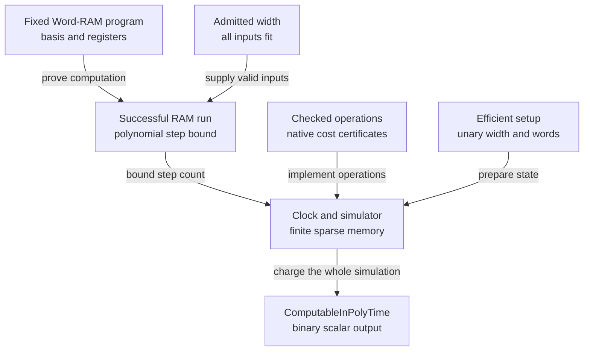

# Word-RAM, random sampling, and Turing bridges

## Concrete machine and operation basis

[CslibFrontier/Computability/WordRAM/Defs.lean](https://github.com/cslib-community/cslib-frontier/blob/13e6a31951bf1c89a1a6258c44f9444aecbbefd8/Complexity/Computability/WordRAM/Defs.lean) uses finite register indices, natural memory addresses and word values below `2^w`. The program is a finite instruction list. The default memory is zero; input length is stored at address zero and input words at `1,…,n`. A scalar result is returned by `halt`, which costs one instruction. Installing the input and reading the result are conventions, not hidden execution steps [cslib-frontier][complexitylib].

`Basis` separates ALU symbols/arity from their interpretation. `standard` uses natural truncated subtraction and Lean's total division/modulo conventions; `exact` faults on subtraction underflow and division/modulo by zero. Both check result width rather than silently wrapping arithmetic modulo `2^w`. Restricted additive/arithmetic bases expose which operations an algorithm uses. `Basis.Hom` preserves interpretation; successful-run simulations can relate a partial basis to a more total one.

Copies and memory moves rely on a bounded-state invariant rather than rechecking every existing word. The program counter is naturally unbounded in the base Word-RAM; code-length/address restrictions are separate. An instruction can explicitly read the width, and `ReadsWidth` tracks that feature. Without it, successful runs have a width-monotonicity theorem.

Structured [CslibFrontier/Computability/WordRAM/Structured.lean](https://github.com/cslib-community/cslib-frontier/blob/13e6a31951bf1c89a1a6258c44f9444aecbbefd8/Complexity/Computability/WordRAM/Structured.lean) has operations, sequencing, branches and loops. Its `Exec` relation counts actual branch/jump overhead, and assembly preserves exact counts. Hoare and potential rules prove executions of this code; they do not treat a source-language loop as one machine instruction.

## Running concrete programs in tests

`Code.eval` runs a structured program on concrete data, and `Exec.of_eval` turns a successful
result into an execution. It keeps registers and memory as `Function.update` chains, so a compiled
`#eval` or `#guard` of a run takes time quadratic in its length. For a run longer than a few
thousand instructions, import
[`Structured.FastEval`](../../CslibFrontier/Computability/WordRAM/Structured/FastEval.lean) in the
test file. Its proved `@[csimp]` lemma makes compiled code use an array-backed interpreter, and the
observations do not change. For example,
[`NativeChanHeVisitor`](../../CslibFrontierTests/NativeChanHeVisitor.lean) drops from about nine
minutes to under ten seconds. The import affects only compiled evaluation. `decide` and `rfl`
still reduce `Code.eval` in the kernel. When such a check is slow in its tactic step rather than in
type checking (see `set_option profiler true`), `decide +kernel` skips the elaborator's evaluation.
Keep the library modules that define programs free of this import, so that it stays a leaf.

On arbitrary data, `ram_eval [myProgram]` from
[`Notation`](../../CslibFrontier/Computability/WordRAM/Notation.lean) proves an `ExecWithin` or
`Exec` goal by running `Code.eval` with `simp`; `ram_exact_eval` does the same for `Basis.exact`
programs. A failure names its step: the goal form, a given simp lemma that does not elaborate, a
program `simp` cannot unfold, a `none` result (a fault, or a loop needing more iterations, as in
`ram_eval 3 [myProgram]`), an undecided branch or an instruction bound that `omega` cannot prove;
the last two are shown. Under `try` or `first` the tactic skips this diagnosis, so an expected
failure costs only the attempt. The
[diagnostic examples](../../CslibFrontierTests/WordRAMEvalDiagnostics.lean) check each message.

## Proving a constant-cost counting loop

Import [`CountingLoop`](../../CslibFrontier/Computability/WordRAM/CountingLoop.lean) for a native
`while index < limit` whose body increments `index` by exactly one. Supply an indexed semantic
invariant `P j state`, show that it retains the fixed limit `N`, and prove the actual body runs
within `T` instructions and establishes `P (j+1)`. Start with `index ≤ N` and `P index state`.
`ExecWithin.loop_count` returns `P N`, `index = N`, and allowance
`(N-index)*(T+2)+2`. This includes two control instructions per iteration and the final exit;
setup and halt are separate. The rule introduces no `Fits (N+1)` requirement.

Keep array contents, aliases, dirty-memory frames and instruction fits in the semantic/body
proof. Derive unchanged registers using `ExecWithin.regs_eq` and `Code.Preserves` when helpful.
The [complete counting-loop client](../../CslibFrontierTests/WordRAMCountingLoop.lean) starts at a
nonzero counter, reaches the largest fitting word, and checks an already-completed loop. It also
runs [Chan–He Padding](../../CslibFrontier/Algorithms/WordRAM/ThreeSum/ChanHe/Padding.lean) from dirty
memory, checking empty/nonempty output and the exact `12*N+5` clock. To check the client, run
`lake build CslibFrontierTests.WordRAMCountingLoop --wfail --iofail` from the repository root after
[setup](../workflows/getting-started.md). If the body skips an index, changes the endpoint or has
an irregular stopping condition, use `ExecWithin.loop_invariant`; for varying iteration charges,
use `ExecWithin.loop_potential` in
[`Structured`](../../CslibFrontier/Computability/WordRAM/Structured.lean).

## Proving routine calls and memory frames

For structured `Code`, import
[`SymbolicExec.Call`](../../CslibFrontier/Computability/WordRAM/SymbolicExec/Call.lean).
Unfold the caller and run `wram_exec` to its named routine. Apply
`wram_call routine_spec with y post`, then resume `wram_exec` using the returned facts.
The routine specification supplies its instruction allowance and full postcondition; the
routine body stays closed. A fixed-time existential contract and a time-indexed `WP` contract
are both supported. In the latter case, bind `y`, the returned allowance, and its postcondition.

The same tactics prove exact instruction counts. On a goal `Exec w c x y T` or
`∃ y, Exec w c x y T ∧ P y`, `wram_exec` runs with the rules of `WP.Exact`, the
weakest-precondition form of `Exec`, and closes the final count `t = T` with `omega` when it can;
a count it cannot close remains as the first conjunct of the goal. At a stop, continue from an
exact specification with `refine WP.Exact.of_exec h ?_`, or apply an exact contract
`∃ y, Exec w c x y T ∧ P y` with `wram_call`. `WP.Exact.toWP` weakens an exact count to a bound.
The [symbolic-execution examples](../../CslibFrontierTests/WordRAMSymbolicExec.lean) check exact
counts through a conditional, a wrong count left as a goal and a call to an exact specification.

`wram_exec` stops at a loop. For a loop proved by induction, take an iteration whose condition
holds with `refine WP.Exact.exists_exec (WP.Exact.loop_iter hc ?_)` (`WP.loop_iter` for a bound),
run the body with `wram_exec`, and apply the induction hypothesis to the loop left at the end with
`wram_call`. Give `_` for the data reached, so that the hypothesis's register facts are proved by
`wram_simp` once it is known. What remains is the instruction count and the postcondition. Pass
`← h` for an abbreviation `set v := e with h` so that values are read back as `v`.
`clmulTabLoop_exec` and `hornerLoop_exec` in
[`KWise`](../../CslibFrontier/DataStructure/HashFamily/WordRAM/KWise.lean) follow this pattern,
the second with calls to exact contracts inside the body; `moveLoop_exec` in the
[symbolic-execution examples](../../CslibFrontierTests/WordRAMSymbolicExec.lean) is the smallest
case.

For an injective bank, use `wram_call routine_spec renamed bank_injective with y ⟨post, frame⟩`.
Here the specification starts from the caller's `Data.comap bank`; `frame` preserves registers
outside the bank. Memory and register projections of bank views are normalized once. Preparation,
callee and continuation allowances add through `WP.seq`; assembly and the final halt retain their
existing separate rules. Missing word fits, alias conditions or a mismatched routine still need
proof. Open the complete ordinary-import
[call examples](../../CslibFrontierTests/WordRAMCallAutomation.lean), including a dirty caller,
its actual continuation, a variable allowance and rejected wrong-code/insufficient-time cases.
When no rule applies, `wram_call` reports the goal, the contract forms accepted there and the
mismatch; those examples check the messages.

`wram_exec` and `wram_simp` read a register past `Data.set` when both names are literals, and
also when names with free variables are distinct by the context: a hypothesis `j ≠ i` either way
round, `j ∉ Set.range f` against a renamed register `f a`, `Function.Injective f` for `f b` and
`f a`, an instance of a quantified disequality `∀ xs, a ≠ b` or `∀ xs, ¬a = b` either way round,
or names such as `i.castAdd 3` and `⟨i + 9, _⟩` whose values the discharger separates. A
quantified hypothesis such as `∀ i j, src i ≠ tmp j` separates two renamed banks. It is used only
when matching its two sides against the names determines every bound variable. A hypothesis with
a premise, such as `∀ i j, i ≠ j → tmp i ≠ tmp j`, is never instantiated; state that fact as
`Function.Injective tmp`. Other names stay unread. Memory passed whole to a definition, as in
`swapMem y.mem i j`, becomes `Function.update`; reads at an address still go through the
discharger. `Data.set_set` drops an overwritten register. The
[symbolic-execution examples](../../CslibFrontierTests/WordRAMSymbolicExec.lean) check each case,
including two banks separated by quantified hypotheses, a premise-bearing hypothesis left unused,
and names left unread.

`wram_exec` also runs `Op.alu` instructions through `WP.alu` (`WP.Exact.alu` for exact counts),
for a basis given by a definition,
such as `Basis.additive` (including `Op.addAdditive`), or for `Basis.standard` written with the
constructor. `Basis.reduceInterp` unfolds the operation on the argument registers' values, and
execution continues only when the result is `some v`. The fitting condition `Fits w v` is
proved like other fitting conditions or left as a goal, and the instruction is charged as one
instruction. An operation that does not unfold to `some v` without comparing the values, such as
`Basis.exact` subtraction, stops `wram_exec` with a `could not evaluate` error; write such
instructions as `Op.exactBin`, which has its own rules. The
[other-bases examples](../../CslibFrontierTests/WordRAMSymbolicExec.lean) check additive and
standard instructions and that failure, and the exact-count examples check both instructions under
`Exec`.

When a continuation would otherwise rebuild many caller-register equalities, import
[`SymbolicExec.CanonicalCall`](../../CslibFrontier/Computability/WordRAM/SymbolicExec/CanonicalCall.lean)
and use `wram_call routine_spec canonical bank_injective with small post` at the same call
boundary. The continuation's caller state is `small.extend bank oldCaller`. Run `wram_exec`
or `wram_simp` with the callee's output facts: closed finite-bank reads normalize individually,
and outside-bank reads return the original caller values. Inside-bank inputs still need actual
callee preservation facts. Memory always comes from `small`, including its writes; a register
frame supplies no memory frame. The raw equations are shared with the subroutine API in
[`RegisterFrame`](../../CslibFrontier/Computability/WordRAM/RegisterFrame.lean).
For symbolic banks use `Data.extend_regs_of_eq` or
`Data.extend_regs_of_forall_ne` explicitly. The complete
[canonical-call examples](../../CslibFrontierTests/WordRAMCanonicalCall.lean) check a permuted bank,
both callee and continuation stores, dirty outside registers, an empty bank and symbolic reads.
Do not unfold `Function.extend`; these read rules keep nested caller states manageable.

For memory readback, import
[`MemoryView`](../../CslibFrontier/Computability/WordRAM/MemoryView.lean).
`ram_keep view using frame` preserves a block, list or finite-footprint assertion when its live
support lies in the supplied `Set.EqOn` frame. Prefix and outside-interval pointwise frames are
also accepted; interval containment is checked with `omega`. `ram_keep view` handles stores
outside a live block. Compose equality frames with `Set.EqOn.trans`, or obtain one from
`Modifies.eqOn` and disjoint read/write supports. Read-only views may overlap and unused cells
may be dirty. If containment fails, supply the missing layout inequality or use the explicit
`.keep` lemma. The [memory-view examples](../../CslibFrontierTests/WordRAMMemoryViews.lean) check
aliasing, empty/exact-endpoint blocks, composed frames and rejected corrupting writes.

## Uniformity and output conventions

[WordSizeDependentProgram](https://github.com/cslib-community/cslib-frontier/blob/13e6a31951bf1c89a1a6258c44f9444aecbbefd8/Complexity/Computability/WordRAM/Time.lean#L149) chooses code from the width with a fixed register count and a global instruction-list-length bound. Literals may depend on width, and the selector itself is uncharged. `UniformDecidableInTime` instead uses one fixed program, which may read the width. These are distinct contracts.

Time bounds, input encodings and permitted input/width pairs can depend on width. Every contract is conditional on `InputFits`. Empty allowed conditions or inputs that never fit can make a proposition vacuous; a logarithmic threshold in the number of input words does not bound those words' values. Input-dependent width schedules can convey advice. These points are explicit in the source and must accompany comparisons with uniform Turing classes.

[CslibFrontier/Computability/WordRAM/Function.lean](https://github.com/cslib-community/cslib-frontier/blob/13e6a31951bf1c89a1a6258c44f9444aecbbefd8/Complexity/Computability/WordRAM/Function.lean) treats scalar word-valued functions. [ExecutesList](https://github.com/cslib-community/cslib-frontier/blob/13e6a31951bf1c89a1a6258c44f9444aecbbefd8/Complexity/Computability/WordRAM/ListOutput.lean#L92) treats list output as the length-prefixed array addressed by the returned word in the pre-halt memory. Returning zero without writing can therefore return the original input. This is an output convention on the same machine; it does not charge the mathematical observer for copying that array out.

## Checking resource-model consequences

[`Runs.exists_footprints`](../../CslibFrontier/Computability/WordRAM/Footprint.lean) bounds distinct
read and written cells by actual continuing instructions. Changing unread initial cells replays
the same control path and registers; `Executes.exists_readFootprint` also preserves the charged
halt and output. These rules permit width-reading instructions and arbitrary deterministic
operation bases.

[`ThreeSum.not_uniformDecidableInO_sublinear`](../../CslibFrontier/Algorithms/WordRAM/ThreeSum/LowerBound.lean)
uses this replay rule on canonical signed, length-prefixed input under the same `Admissible`
domain as the fast algorithm. Changing any tail entry of `[1,-1,1,…,1]` to zero changes the
answer, so every tail cell must be read. The result excludes exponents below one in the existing
uniform time API, including magnitude exponent zero and all admitted wider words.

For output, use
[`Runs.card_changed_le` or `Runs.block_lowerBound`](../../CslibFrontier/Computability/WordRAM/OutputLowerBound.lean):
each distinct changed cell needs a store. `ExecutesList.denseMatrix_lowerBound` specializes this
to materializing an all-one square matrix from initialized zero input, with its chosen output
pointer unrestricted and halt charged. Output length alone gives no such lower bound when the
answer already occupies input memory. The
[model examples](../../CslibFrontierTests/WordRAM/ModelLowerBounds.lean) include an actual initialized
one-entry matrix run and the zero-entry boundary case.

## Proved deterministic bridges

| Bridge | Statement and costs | Restrictions |
|---|---|---|
| Word-RAM ↔ generic interpreter | `step_toGeneric`, `run_toGeneric`, `executes_toGeneric_iff` in [CslibFrontier/Computability/WordRAM/Defs.lean](https://github.com/cslib-community/cslib-frontier/blob/13e6a31951bf1c89a1a6258c44f9444aecbbefd8/Complexity/Computability/WordRAM/Defs.lean) | Same basis, exact state correspondence and step count |
| Multitape TM → Word-RAM | `ComputableInPolyTime.exists_wordRAM` and `exists_wordRAM_nat` in [CslibFrontier/Computability/WordRAM/OfTuring.lean](https://github.com/cslib-community/cslib-frontier/blob/13e6a31951bf1c89a1a6258c44f9444aecbbefd8/Complexity/Computability/WordRAM/OfTuring.lean) | One fixed additive program; tapes represented by interleaved addresses; scalar answer must fit |
| Space-bounded multitape TM → Word-RAM | `executes_simProgram_of_runsInSpace` and `uniformDecidableInTimeLogWord_of_decidableInTimeAndSpace` in [CslibFrontier/Computability/WordRAM/OfTuring/Space.lean](../../CslibFrontier/Computability/WordRAM/OfTuring/Space.lean) | Same simulator; words hold addresses linear in the work space, not the running time, so polynomial work space gives logarithmic width at any running time; decision bit only |
| Word-RAM → native TM | [CslibFrontier/Computability/WordRAM/Turing/Overhead.lean](https://github.com/cslib-community/cslib-frontier/blob/13e6a31951bf1c89a1a6258c44f9444aecbbefd8/Complexity/Computability/WordRAM/Turing/Overhead.lean) | Efficient scalar operations, encoded fitted input, width and step budget construction charged |
| Polynomial-time decisions | [mem_P_iff_uniformPolynomialTime](https://github.com/cslib-community/cslib-frontier/blob/13e6a31951bf1c89a1a6258c44f9444aecbbefd8/Complexity/Computability/Complexity/Classes/P/WordRAM.lean#L153) | Fixed program; basis contains additive operations and has polynomial native scalar cost; specified encoding and threshold |
| Polynomial-time scalar functions | [CslibFrontier/Computability/WordRAM/Invariance.lean](https://github.com/cslib-community/cslib-frontier/blob/13e6a31951bf1c89a1a6258c44f9444aecbbefd8/Complexity/Computability/WordRAM/Invariance.lean) | General polynomial-bit answers use a polynomial width threshold; logarithmic-width equivalence additionally requires polynomially bounded answer values |
| Word-RAM → unbounded log-cost RAM | [CslibFrontier/Computability/WordRAM/RAM.lean](https://github.com/cslib-community/cslib-frontier/blob/13e6a31951bf1c89a1a6258c44f9444aecbbefd8/Complexity/Computability/WordRAM/RAM.lean) | Additive fragment; eight target slots per instruction; successful forward simulation, not overflow-reflecting equivalence |

The fixed-program, scalar-output route to native polynomial time has these inputs:

Every incoming requirement is explicit in [Program.ComputesInTime.turingComputableInPolyTime_of_width](https://github.com/cslib-community/cslib-frontier/blob/13e6a31951bf1c89a1a6258c44f9444aecbbefd8/Complexity/Computability/WordRAM/Turing.lean#L514). The chosen width is computable in unary, the fitted input words are computable from the original encoding, and each checked basis operation has a native certificate. The bounds are measured in that original encoded input length. [WordRAMTuring](https://github.com/cslib-community/cslib-frontier/blob/13e6a31951bf1c89a1a6258c44f9444aecbbefd8/ComplexityTests/WordRAMTuring.lean#L65) demonstrates the route. List-output and width-selected code use their own contracts.

The reverse TM simulation's displayed overhead for a `T`-step, `n`-word, width-`w` run with scalar degree `d` is `O((T+1)*((n+T+1)*(w+1))^max(3,d))`, in addition to setup/clock obligations. The cubic floor reflects the finite association-list representation used by this simulator; it is not asserted to be an optimal RAM/TM overhead. The additive case has scalar degree two and still pays this cubic floor.

The time-bounded inclusion `DTIME_subset_RAMTIME_additive` needs a polynomially bounded running time because the simulator's addresses grow with time. A decider with polynomial work space and super-polynomial time instead goes through [`uniformDecidableInTimeLogWord_of_decidableInTimeAndSpace`](../../CslibFrontier/Computability/WordRAM/OfTuring/Space.lean). [`uniformDecidableInTimeLogWord_KSAT`](../../CslibFrontier/Computability/Complexity/FineGrained/WordRAM.lean) applies it to the native model counter: for every `δ > 0`, one fixed additive program decides `k`-SAT on the bits of `encCNF φ` within `O(⌈2^(δ n)⌉ (L + 1)^e)` instructions at logarithmic width, so ETH fails on that word RAM too. The work-space bound must come from the decider's own contract; `DecidableInTimeO` forgets it.

For scalar functions, polynomial output **bit length** differs from polynomial output **value**. `UniformComputableInPolyTime.polyBounded` records the necessity of the latter for a logarithmic-width scalar output. The general-width equivalence and logarithmic-width equivalence should not be merged into one unqualified theorem.

## Retain concrete realization resources

For a fixed register count or exchange factor, retain a
[`Realizes.Witness`](../../CslibFrontier/Computability/WordRAM/Realization/Witness.lean) as data.
Its `scratchSize`, `factor` and `code` fields satisfy the same `Realizes.Spec` execution contract
used by the existential `Realizes` judgment: bounded entry data, encoded live inputs, explicit
safe domain and valid memory history, full memory/frontier equality, result words and register
frame. `Witness.toRealizes` erases the selected data when only existence is needed.

Supply that witness as the `realizes` field of the existing
[`Certificate`](../../CslibFrontier/Computability/WordRAM/Realization/Backend.lean). The same
`Backend.registers`, `Backend.code` and `Backend.factor` retain its fields. If a client has only
an existential proof `h : Realizes ...`, use `Certificate.ofRealizes h`; this preserves correctness
using classical choice. It does not prove that the chosen scratch size, factor or code equals
those in a preferred derivation. Erasing a supplied witness and selecting again loses that
implementation identity.

The four primitive witnesses `readWitness`, `writeWitness`, `allocDirtyWitness` and `allocWitness`
reuse the existing primitive execution proofs. The concrete
[`MemoryBackend`](../../CslibFrontier/Computability/WordRAM/Realization/MemoryBackend.lean) family
uses them through the generic Backend and proves seven registers and factor four. Open the
complete [checked client](../../CslibFrontierTests/WordRAMMemoryBackend.lean): allocate two cells,
write seven at the returned address and read it back, with final frontier five, an unrelated
dirty cell unchanged and at most 32 body instructions. It also checks empty allocations at width zero.
Arguments are already delivered by an **uncharged** calling convention; this bound does not
include native client control, argument installation, result decoding or halt.

For a runtime conditional, use
[`Realizes.Witness.branch`](../../CslibFrontier/Computability/WordRAM/Realization/Branch.lean)
on two supplied witnesses. It keeps their common temporary prefix, reserving
`max left.scratchSize right.scratchSize`, with factor `max left.factor right.factor + 2`.
Only the selected arm's domain and memory history are required. The selected local work gains
two units for native branch control; choosing an arm does not execute the other one.
The existential `Realizes.branch` reuses this construction by erasure.

The [branch client](../../CslibFrontierTests/WordRAMRealizationBranchWitness.lean) has three runtime
words: a selector and two allocation counts. It compares the selector with the first count,
then clears the selected allocation. Each supplied arm needs two auxiliary words, so the same
generic Backend uses **eight registers**, versus ten with the former sum reservation, and
factor six. Both outcomes check the full memory/frontier result on dirty memory, an invalid
unselected allocation and empty allocation at width zero. The bound includes the native
conditional but still uses the delivered-argument, body-only calling convention above.

This explicit route does not retain concrete witnesses through every bind, loop or
randomized constructor. Existing existential Backend clients remain available through the
choice fallback. Fixed-resource Karger endpoints still need their own compatible emitter and
resource proofs; no fixed-resource Karger bound follows from this example.

### Retain scalar code and share its scratch bank

Import `CslibFrontier.Computability.WordRAM.Realization.GlueVector`. For a concrete scalar
implementation, retain a `GlueComputes.Witness` rather than erase it to `GlueComputes` and
select again. The `proj`, `const`, `binary` and `binExact` data constructors reuse the original
scalar execution contract and proofs. Projections and constants have zero auxiliary slots;
`binary` retains `a+b+2` auxiliary slots for operands with scratch sizes `a` and `b`. Exact
subtraction and division still require their explicit definedness premises: a fitting output
alone does not justify underflow or division by zero. Input registers may repeat, and the
scalar rules require no whole-state boundedness premise.

Pass those supplied scalars directly to `Realizes.Witness.glueVectorOfScalars`. Coordinates run
sequentially, sharing the **maximum** auxiliary bank while each result gets its own persistent
output slot. Each output copy and the final neutral copy are charged. The existing
`Witness.glueVector` and `Realizes.glueVector` proposition-based interfaces remain available,
but their classical-choice fallback gives no concrete scratch or code identity.

The complete [checked client](../../CslibFrontierTests/WordRAMScalarWitness.lean) computes
`(cursor+1, accumulator+value)` with two specified three-instruction scalar additions. Its
actual supplied Backend has nine registers and a nine-instruction body allowance. Replaying
the original sum-bank placement on these **same supplied scalar data** gives eleven registers;
this is not a numerical claim about witnesses selected from old existential proofs. The tests
check maximum-word output, full dirty-memory/frontier/live-register preservation, actually
aliased input registers, overflow-domain exclusion and a width-zero projection. Argument
installation and a caller halt remain separate charges. No sixteen-register Karger endpoint
or whole-initializer bound follows from this standalone client.

### Keep native loop overhead additive

When a memory loop already has a retained body witness, keep that data through
`Witness.iterateRuntime` and use `Witness.loopEmit_spec` for a tighter clock on the **same**
`loopEmit` instructions. For a state of `l` words and runtime fuel `q`, its bound is
`C*(memoryCost + iterationWork) + (l+5)*(q+1)`. Here `iterationWork` includes one unit per
iteration. Counter setup, state/result copies, decrement, tests and exit remain paid. The
coarse witness factor is still available; substituting that coarse factor into an outer clock
can lose this sharper accounting. This rule retains the full original execution contract,
including reached domains, memory/frontier, outputs and the register frame.

Open the complete [checked Backend client](../../CslibFrontierTests/WordRAMRealizationAdditiveLoop.lean),
which reuses the existing query-free `identityBody` source. From this checkout, run
`scripts/build.sh --wfail --iofail CslibFrontierTests.WordRAMRealizationAdditiveLoop`.
Its retained vector-glue body has a three-instruction allowance, including the result and
neutral copies. The one-word loop therefore runs within `9*q+6` body instructions even though
it performs no memory query. The SAME Backend code handles value seven/fuel two at width three
within 24 instructions, preserving all dirty memory and frontier three. At width zero/fuel zero
it returns zero within six instructions, without assuming that one fits a zero-width word.
Both cases retain the full live-register frame.

The scalar glue emitter is selected once from its fixed-time certificate; its scratch size
remains a retained parameter, not a proved numeral. This example gives a numerical time bound
without a fixed register-count claim. Argument installation and caller halt are separate charges.
It does not identify the supplied code with a witness chosen from an arbitrary existential proof.

## Randomized instructions and exact laws

[CslibFrontier/Computability/WordRAM/Randomized/Defs.lean](https://github.com/cslib-community/cslib-frontier/blob/13e6a31951bf1c89a1a6258c44f9444aecbbefd8/Complexity/Computability/WordRAM/Randomized/Defs.lean) keeps the same flat instruction syntax and gives `rand dst src` the exact uniform law on `0,…,R[src]`, provided the bound fits. The deterministic interpreter faults on `rand`; the probabilistic interpreter produces a `ProbComp` tree. Halted and faulted outcomes are absorbing, and a halt retains final registers and memory.

The extension records worst-case successful halting, fault-freedom, random-call count and an explicit bit currency. Even `rand 0` makes one call while consuming zero bits in that currency. A bound of `R` calls implies at most `R*w` such bits. This is a unit-cost finite-uniform-word model, not an assertion that every instruction is exactly executable in bounded fair-coin time. The native strict-PPT distinction is explained in [programs and realization](../programs-crypto-and-probability/programs-and-realization.md).

[CslibFrontier/Computability/WordRAM/Randomized/Structured.lean](https://github.com/cslib-community/cslib-frontier/blob/13e6a31951bf1c89a1a6258c44f9444aecbbefd8/Complexity/Computability/WordRAM/Randomized/Structured.lean) uses `ExecRand` to certify a finite fault-free structured execution tree with the distribution of final data and exact instruction count. Compilation and random/cost bounds preserve its law.

### Realize memory clients with private coins

Import `CslibFrontier.Computability.WordRAM.Realization.Random` for
[`RealizesRand`](../../CslibFrontier/Computability/WordRAM/Realization/Random.lean), and
`CslibFrontier.Computability.WordRAM.Realization.RandomLoop` for runtime-bounded iteration.
Start with a memory client with private coins, faithful input/output word encodings, a safe
entry domain, and separate time and random-call budgets. The realization chooses its emitter,
scratch size and exchange constant before runtime arguments, word widths and initial memories.
It requires bounded initial data, the encoded argument in its source registers, disjoint
scratch/frontier placement, the safe-domain premise and demonic admissibility of the client.

[`ExecRandLaw`](../../CslibFrontier/Computability/WordRAM/Randomized/Law.lean) relates the emitted
code to the **joint** law of encoded result words and the entire memory function and frontier.
A result-only marginal cannot preserve a later memory-dependent call. The code keeps registers
outside its scratch bank and frontier, and every path terminates within `C*(time+1)` native
instructions and the separate random-call budget. Deterministic components enter through an
existing `Realizes` certificate and `Realizes.toRand`; their time is memory charge plus local
work and their random-call budget is zero.

`RealizesRand.bind` requires the continuation's domain and uniform time/call bounds for every
supported intermediate answer and memory. `RealizesRand.iterate` requires the corresponding
bounds at every supported loop prefix, using one body emitter. Supply those obligations at
reached memories; a bound only at the initial state, or only in expectation, is insufficient.
The native rules account for register copies, loop counters, headers and exits.

`RealizesRand.exists_init_program` compiles a selected result coordinate to the existing flat
program semantics, retaining its joint law with full memory/frontier and exporting both
`RandHaltsWithin` and `RandCallsBounded`. Keep the raw-input prefix equality, length/fit,
safe-domain and demonic-admissibility premises. `Data.init` raw-memory placement is an
**uncharged calling convention**; the charged `2*k+5` native prefix installs the frontier and
first `k` argument registers, not the whole graph. Its allowance `C*(time+1)+1` includes that
prefix, the body and trailing halt. The random budget counts primitive inclusive-range calls,
even `rand(0)`; it does not prove a bounded-cost exact fair-bit sampler.

Open the complete checked
[WordRAMRealizationRandom clients](../../CslibFrontierTests/WordRAMRealizationRandom.lean),
including their imports and encodings. `sample_program` samples an input position, retaining
repeated values' multiplicity; its input is nonempty and must fit. The runtime-repeat client
bounds every iteration. `storeSample_result_eq_cell` and `realizesRand_storeSample` retain the
correlation between the returned sample and the written cell, while preserving other memory
and the frontier. These are realization clients, not a completed native Karger implementation:
K2 still needs its method/setup and exact-resource deletion train, and K3 needs recursive
frame-stack realization. No expected-cost or uniform-word claim becomes a strict fair-coin
runtime claim through this interface.

## Expected time and unbounded termination

[expectedTime](https://github.com/cslib-community/cslib-frontier/blob/13e6a31951bf1c89a1a6258c44f9444aecbbefd8/Complexity/Computability/WordRAM/Randomized/Expected.lean#L165) sums, over horizons `t`, the probability that execution is still running. It is valued in extended nonnegative reals. Since both halt and fault are absorbing, this is time until either; concluding almost-sure **successful** halting also requires fault-freedom. `Executes.expectedTime_eq` recovers deterministic instruction counts, and worst-case halting reduces the sum to a finite horizon.

There are two structured interfaces. `expectedCodeTime` uses the finite fault-free `ExecRand` tree when one exists and is infinite otherwise; it can conservatively assign infinity to an unbounded almost-surely terminating loop. `ExecCodeDist` separately pairs a genuine output PMF with an expected step bound and supports unbounded geometric Las Vegas loops via `ExecCodeDist.loop_geometric` and `program_halts`. Distinguish this distributional certificate from finite-tree structured execution.

## Known Limitations

The inspected bridges establish their explicit deterministic models and encodings. They do not give a blanket equivalence for arbitrary width advice, arbitrary mathematical input encodings, all unbounded-integer operations at unit cost, or the randomized uniform-word instruction under strict fair-coin time. List-output extraction and dynamic caller argument preparation have their stated conventions; full end-to-end costs require a native caller when those steps matter.

[complexitylib]: ../sources.md#complexitylib
