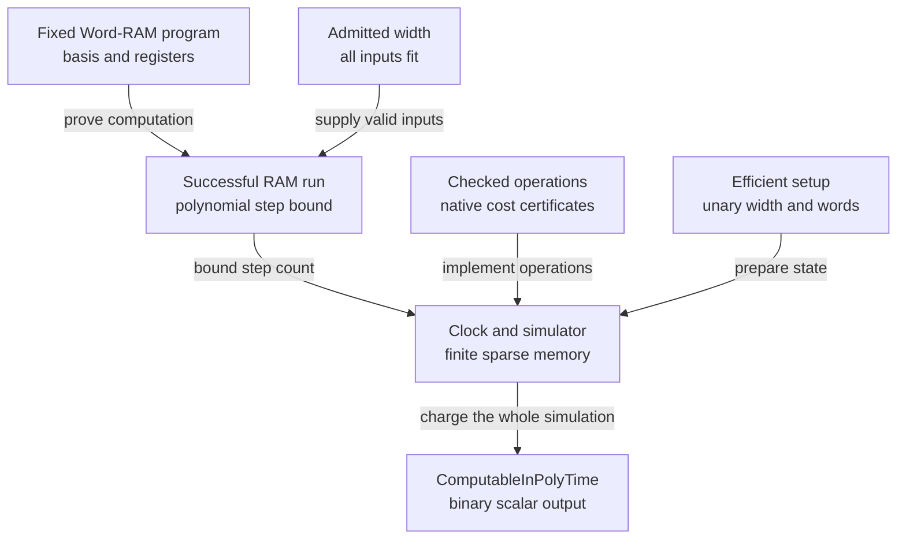

# Word-RAM, random sampling, and Turing bridges

## Concrete machine and operation basis

[Complexity/Computability/WordRAM/Defs.lean](https://github.com/cslib-community/complexitylib/blob/13e6a31951bf1c89a1a6258c44f9444aecbbefd8/Complexity/Computability/WordRAM/Defs.lean) uses finite register indices, natural memory addresses and word values below `2^w`. The program is a finite instruction list. The default memory is zero; input length is stored at address zero and input words at `1,…,n`. A scalar result is returned by `halt`, which costs one instruction. Installing the input and reading the result are conventions, not hidden execution steps [complexitylib][complexitylib].

`Basis` separates ALU symbols/arity from their interpretation. `standard` uses natural truncated subtraction and Lean's total division/modulo conventions; `exact` faults on subtraction underflow and division/modulo by zero. Both check result width rather than silently wrapping arithmetic modulo `2^w`. Restricted additive/arithmetic bases expose which operations an algorithm uses. `Basis.Hom` preserves interpretation; successful-run simulations can relate a partial basis to a more total one.

Copies and memory moves rely on a bounded-state invariant rather than rechecking every existing word. The program counter is naturally unbounded in the base Word-RAM; code-length/address restrictions are separate. An instruction can explicitly read the width, and `ReadsWidth` tracks that feature. Without it, successful runs have a width-monotonicity theorem.

Structured [Complexity/Computability/WordRAM/Structured.lean](https://github.com/cslib-community/complexitylib/blob/13e6a31951bf1c89a1a6258c44f9444aecbbefd8/Complexity/Computability/WordRAM/Structured.lean) has operations, sequencing, branches and loops. Its `Exec` relation counts actual branch/jump overhead, and assembly preserves exact counts. Hoare and potential rules prove executions of this code; they do not treat a source-language loop as one machine instruction.

## Uniformity and output conventions

[WordSizeDependentProgram](https://github.com/cslib-community/complexitylib/blob/13e6a31951bf1c89a1a6258c44f9444aecbbefd8/Complexity/Computability/WordRAM/Time.lean#L149) chooses code from the width with a fixed register count and a global instruction-list-length bound. Literals may depend on width, and the selector itself is uncharged. `UniformDecidableInTime` instead uses one fixed program, which may read the width. These are distinct contracts.

Time bounds, input encodings and permitted input/width pairs can depend on width. Every contract is conditional on `InputFits`. Empty allowed conditions or inputs that never fit can make a proposition vacuous; a logarithmic threshold in the number of input words does not bound those words' values. Input-dependent width schedules can convey advice. These points are explicit in the source and must accompany comparisons with uniform Turing classes.

[Complexity/Computability/WordRAM/Function.lean](https://github.com/cslib-community/complexitylib/blob/13e6a31951bf1c89a1a6258c44f9444aecbbefd8/Complexity/Computability/WordRAM/Function.lean) treats scalar word-valued functions. [ExecutesList](https://github.com/cslib-community/complexitylib/blob/13e6a31951bf1c89a1a6258c44f9444aecbbefd8/Complexity/Computability/WordRAM/ListOutput.lean#L92) treats list output as the length-prefixed array addressed by the returned word in the pre-halt memory. Returning zero without writing can therefore return the original input. This is an output convention on the same machine; it does not charge the mathematical observer for copying that array out.

## Proved deterministic bridges

| Bridge | Statement and costs | Restrictions |
|---|---|---|
| Word-RAM ↔ generic interpreter | `step_toGeneric`, `run_toGeneric`, `executes_toGeneric_iff` in [Complexity/Computability/WordRAM/Defs.lean](https://github.com/cslib-community/complexitylib/blob/13e6a31951bf1c89a1a6258c44f9444aecbbefd8/Complexity/Computability/WordRAM/Defs.lean) | Same basis, exact state correspondence and step count |
| Multitape TM → Word-RAM | `ComputableInPolyTime.exists_wordRAM` and `exists_wordRAM_nat` in [Complexity/Computability/WordRAM/OfTuring.lean](https://github.com/cslib-community/complexitylib/blob/13e6a31951bf1c89a1a6258c44f9444aecbbefd8/Complexity/Computability/WordRAM/OfTuring.lean) | One fixed additive program; tapes represented by interleaved addresses; scalar answer must fit |
| Word-RAM → native TM | [Complexity/Computability/WordRAM/Turing/Overhead.lean](https://github.com/cslib-community/complexitylib/blob/13e6a31951bf1c89a1a6258c44f9444aecbbefd8/Complexity/Computability/WordRAM/Turing/Overhead.lean) | Efficient scalar operations, encoded fitted input, width and step budget construction charged |
| Polynomial-time decisions | [mem_P_iff_uniformPolynomialTime](https://github.com/cslib-community/complexitylib/blob/13e6a31951bf1c89a1a6258c44f9444aecbbefd8/Complexity/Computability/Complexity/Classes/P/WordRAM.lean#L153) | Fixed program; basis contains additive operations and has polynomial native scalar cost; specified encoding and threshold |
| Polynomial-time scalar functions | [Complexity/Computability/WordRAM/Invariance.lean](https://github.com/cslib-community/complexitylib/blob/13e6a31951bf1c89a1a6258c44f9444aecbbefd8/Complexity/Computability/WordRAM/Invariance.lean) | General polynomial-bit answers use a polynomial width threshold; logarithmic-width equivalence additionally requires polynomially bounded answer values |
| Word-RAM → unbounded log-cost RAM | [Complexity/Computability/WordRAM/RAM.lean](https://github.com/cslib-community/complexitylib/blob/13e6a31951bf1c89a1a6258c44f9444aecbbefd8/Complexity/Computability/WordRAM/RAM.lean) | Additive fragment; eight target slots per instruction; successful forward simulation, not overflow-reflecting equivalence |

The fixed-program, scalar-output route to native polynomial time has these inputs:

Every incoming requirement is explicit in [Program.ComputesInTime.turingComputableInPolyTime_of_width](https://github.com/cslib-community/complexitylib/blob/13e6a31951bf1c89a1a6258c44f9444aecbbefd8/Complexity/Computability/WordRAM/Turing.lean#L514). The chosen width is computable in unary, the fitted input words are computable from the original encoding, and each checked basis operation has a native certificate. The bounds are measured in that original encoded input length. [WordRAMTuring](https://github.com/cslib-community/complexitylib/blob/13e6a31951bf1c89a1a6258c44f9444aecbbefd8/ComplexityTests/WordRAMTuring.lean#L65) demonstrates the route. List-output and width-selected code use their own contracts.

The reverse TM simulation's displayed overhead for a `T`-step, `n`-word, width-`w` run with scalar degree `d` is `O((T+1)*((n+T+1)*(w+1))^max(3,d))`, in addition to setup/clock obligations. The cubic floor reflects the finite association-list representation used by this simulator; it is not asserted to be an optimal RAM/TM overhead. The additive case has scalar degree two and still pays this cubic floor.

For scalar functions, polynomial output **bit length** differs from polynomial output **value**. `UniformComputableInPolyTime.polyBounded` records the necessity of the latter for a logarithmic-width scalar output. The general-width equivalence and logarithmic-width equivalence should not be merged into one unqualified theorem.

## Randomized instructions and exact laws

[Complexity/Computability/WordRAM/Randomized/Defs.lean](https://github.com/cslib-community/complexitylib/blob/13e6a31951bf1c89a1a6258c44f9444aecbbefd8/Complexity/Computability/WordRAM/Randomized/Defs.lean) keeps the same flat instruction syntax and gives `rand dst src` the exact uniform law on `0,…,R[src]`, provided the bound fits. The deterministic interpreter faults on `rand`; the probabilistic interpreter produces a `ProbComp` tree. Halted and faulted outcomes are absorbing, and a halt retains final registers and memory.

The extension records worst-case successful halting, fault-freedom, random-call count and an explicit bit currency. Even `rand 0` makes one call while consuming zero bits in that currency. A bound of `R` calls implies at most `R*w` such bits. This is a unit-cost finite-uniform-word model, not an assertion that every instruction is exactly executable in bounded fair-coin time. The native strict-PPT distinction is explained in [programs and realization](../programs-crypto-and-probability/programs-and-realization.md).

[Complexity/Computability/WordRAM/Randomized/Structured.lean](https://github.com/cslib-community/complexitylib/blob/13e6a31951bf1c89a1a6258c44f9444aecbbefd8/Complexity/Computability/WordRAM/Randomized/Structured.lean) uses `ExecRand` to certify a finite fault-free structured execution tree with the distribution of final data and exact instruction count. Compilation and random/cost bounds preserve its law.

## Expected time and unbounded termination

[expectedTime](https://github.com/cslib-community/complexitylib/blob/13e6a31951bf1c89a1a6258c44f9444aecbbefd8/Complexity/Computability/WordRAM/Randomized/Expected.lean#L165) sums, over horizons `t`, the probability that execution is still running. It is valued in extended nonnegative reals. Since both halt and fault are absorbing, this is time until either; concluding almost-sure **successful** halting also requires fault-freedom. `Executes.expectedTime_eq` recovers deterministic instruction counts, and worst-case halting reduces the sum to a finite horizon.

There are two structured interfaces. `expectedCodeTime` uses the finite fault-free `ExecRand` tree when one exists and is infinite otherwise; it can conservatively assign infinity to an unbounded almost-surely terminating loop. `ExecCodeDist` separately pairs a genuine output PMF with an expected step bound and supports unbounded geometric Las Vegas loops via `ExecCodeDist.loop_geometric` and `program_halts`. Distinguish this distributional certificate from finite-tree structured execution.

## Known Limitations

The inspected bridges establish their explicit deterministic models and encodings. They do not give a blanket equivalence for arbitrary width advice, arbitrary mathematical input encodings, all unbounded-integer operations at unit cost, or the randomized uniform-word instruction under strict fair-coin time. List-output extraction and dynamic caller argument preparation have their stated conventions; full end-to-end costs require a native caller when those steps matter.

[complexitylib]: ../sources.md#complexitylib
