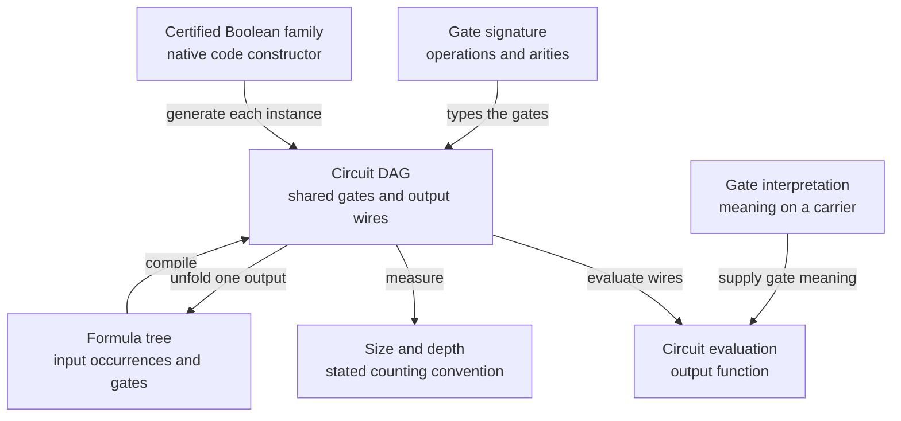

# Circuits and formulas

The circuit architecture separates syntax from meaning. Upstream CSLib supplies a signature of operation symbols and arities, an interpretation of those symbols on a carrier, and a straight-line program indexed by its number of gates. A new line can refer only to inputs or earlier gates. A circuit adds a finite list of designated output wires. Topological validity is therefore part of the type, while gate meaning is a parameter. The central definition is [Circuit](https://github.com/leanprover/cslib/blob/254e30e6d4299c51323aaeaf5f51a4763b375d4a/Cslib/Computability/Circuit/Basic.lean#L46); `Program`, `Line` and `Wire` live in the same pinned upstream circuit directory. [cslib][cslib]

The arrows distinguish parameters, evaluation and constructions. [Formula compilation](https://github.com/cslib-community/complexitylib/blob/13e6a31951bf1c89a1a6258c44f9444aecbbefd8/Complexity/Computability/Circuit/Formula.lean#L724) gives one circuit output; [unfolding an output](https://github.com/cslib-community/complexitylib/blob/13e6a31951bf1c89a1a6258c44f9444aecbbefd8/Complexity/Computability/Circuit/Unfolding.lean#L182) can duplicate shared gates. The constructor node refers to [exists_uniformCircuitFamily](https://github.com/cslib-community/complexitylib/blob/13e6a31951bf1c89a1a6258c44f9444aecbbefd8/Complexity/Computability/Complexity/Problems/CircuitValue/Compilation.lean#L142), which requires polynomial-time input/output widths and a polynomial-time evaluator. An arbitrary size or depth bound supplies neither that constructor nor a native runtime bound.

## What size and depth mean

A circuit's size is the number of operation gates. Inputs, projections, fan-out, repeated output designation and wiring are free. A constant costs a gate when represented by a nullary operation. Depth is the maximum depth of the designated outputs, so a syntactically present but unused gate contributes to size without necessarily contributing to output depth. Syntactic dead-gate elimination (`Circuit.NoDeadGates` and `Circuit.exists_noDeadGates`, distinct from semantic duplicate-gate merging `Circuit.Irredundant`), wire out-degrees, critical paths, and the `2 * n - 2 * m` fan-in-`2` gate lower bound under disjoint critical paths live in [`Complexity/Computability/Circuit/CriticalPath.lean`](../../Complexity/Computability/Circuit/CriticalPath.lean), with the `B₂` (`fullInterpretation (k := 2)`) critical-path intersection bottleneck in [`Complexity/Computability/Circuit/Boolean/CriticalPath.lean`](../../Complexity/Computability/Circuit/Boolean/CriticalPath.lean) [fly22][fly22]. These conventions are explicitly different from presentations that count input nodes. Weighted `Program.cost` and depth interfaces let a theorem count only selected operations. [complexitylib][complexitylib]

[ecomplexityFrom](https://github.com/cslib-community/complexitylib/blob/13e6a31951bf1c89a1a6258c44f9444aecbbefd8/Complexity/Computability/Circuit/SourceComplexity.lean#L129) generalizes ordinary input coordinates to a family of available source functions. A proof of synthesis assembles new functions from those sources and gives a cost certificate. The distinction between `comp` and `trans` matters to clients: composition retaining intermediate functions supports later reuse, while a final-output composition can forget them. Extended-natural complexity records impossibility as infinity. Such a certificate is a mathematical circuit construction; the cost of generating or encoding the circuit needs its own theorem. See [the synthesis interface](https://github.com/cslib-community/complexitylib/blob/13e6a31951bf1c89a1a6258c44f9444aecbbefd8/Complexity/Computability/Circuit/Synthesis.lean).

[Formula](https://github.com/cslib-community/complexitylib/blob/13e6a31951bf1c89a1a6258c44f9444aecbbefd8/Complexity/Computability/Circuit/Formula.lean#L104) is a tree rather than a shared DAG. `Formula.leafSize` counts input occurrences and assigns constants zero; `Formula.size` counts operation nodes. A formula compiles to a circuit, and a circuit can be unfolded into a formula, but unfolding can duplicate shared computations. Formula lower bounds therefore state the relevant tree measure explicitly. This distinction supports the library's Spira, Khrapchenko, Subbotovskaya and Andreev developments.

For an executable arithmetic trace, import `Complexity.Computability.Circuit.Arithmetic.EvaluationTime` ([source](../../Complexity/Computability/Circuit/Arithmetic/EvaluationTime.lean)). `Arithmetic.computableInPolyTime_evalCode` certifies the existing [total code evaluator](../../Complexity/Computability/Circuit/Encoding/Evaluation.lean) for every runtime input list and gate list over a fixed finite semiring with a fixed scalar encoding. The entire code is charged: operations use `ArithOp.encoding`, argument indices use binary encoding, and the output contains the inputs followed by every gate value. `Program.evalCode_code` and `Circuit.eval_eq_getD` identify this output with the canonical typed trace and designated outputs. Missing arguments and invalid wire indices read zero; extra arguments are ignored according to the operation arity. The runtime bound remains valid on those malformed lists, using bounded lookup rather than allocating to an unchecked index. Only valid circuit codes receive the typed semantic interpretation. Run `scripts/build.sh ComplexityTests.ArithmeticCodeEvaluation` for the [F4 clients](../../ComplexityTests/ArithmeticCodeEvaluation.lean), including a runtime-length multiplication family, shared wires, constants, empty code and a `2^100` invalid index. The carrier is fixed: this is neither uniform growing-field arithmetic nor a complete native VOLE protocol certificate.

## Boolean bases and related models

| Model | Meaning | Main use or boundary |
|---|---|---|
| [Op](https://github.com/leanprover/cslib/blob/254e30e6d4299c51323aaeaf5f51a4763b375d4a/Cslib/Computability/Circuit/Boolean/Basic.lean#L29) | Constants, NOT, binary AND/OR | Default all-gate Boolean size; P/poly and machine simulation. |
| [Op](https://github.com/cslib-community/complexitylib/blob/13e6a31951bf1c89a1a6258c44f9444aecbbefd8/Complexity/Computability/Circuit/Monotone/Basic.lean#L46) | Constants and binary AND/OR | Monotone clique/matching lower bounds; monotone KW. |
| [Op](https://github.com/cslib-community/complexitylib/blob/13e6a31951bf1c89a1a6258c44f9444aecbbefd8/Complexity/Computability/Circuit/Boolean/Unbounded.lean#L58) | NOT and arbitrary fan-in AND/OR, including nullary gates | AC0, switching lemmas and bounded independence. |
| [modGate](https://github.com/cslib-community/complexitylib/blob/13e6a31951bf1c89a1a6258c44f9444aecbbefd8/Complexity/Computability/Circuit/Boolean/ModGates.lean#L36) | Unbounded Boolean basis plus nonzero-residue MOD-q | AC0[q], ACC0; odd-prime parity bounds. |
| [Op](https://github.com/cslib-community/complexitylib/blob/13e6a31951bf1c89a1a6258c44f9444aecbbefd8/Complexity/Computability/Circuit/Boolean/Threshold.lean#L66) | Count of true inputs at least j | Equivalent constant-depth class to majority TC0. |
| [Op](https://github.com/cslib-community/complexitylib/blob/13e6a31951bf1c89a1a6258c44f9444aecbbefd8/Complexity/Computability/Circuit/Boolean/WeightedThreshold.lean#L72) | Real weighted sum at least a real threshold | Real-weight lower-bound and capacity arguments. |
| [ActivationOp](https://github.com/cslib-community/complexitylib/blob/13e6a31951bf1c89a1a6258c44f9444aecbbefd8/Complexity/Computability/Circuit/Boolean/WeightedThreshold/Activation.lean#L62) | Real affine score followed by a Boolean activation | Capacity theorems under bounded-change hypotheses. |
| [OracleOp](https://github.com/cslib-community/complexitylib/blob/13e6a31951bf1c89a1a6258c44f9444aecbbefd8/Complexity/Computability/Circuit/Boolean/Oracle.lean#L67) | Oracle call on any finite query arity | P/poly oracle inlining; query lengths matter. |

Repeated wires have genuine meaning for symmetric gates. [MultOp](https://github.com/cslib-community/complexitylib/blob/13e6a31951bf1c89a1a6258c44f9444aecbbefd8/Complexity/Computability/Circuit/Boolean/Multiplicity.lean#L63) preserves their multiplicities while normalizing distinct fan-in. Likewise, a real-weight threshold gate has no coefficient-bitlength bound merely because it is one operation: its size measure is algebraic/semantic, not native bit cost. Depth-two weighted threshold bounds (`THR ∘ THR`) are stated against `WeightedThreshold.signature` either via `c.depth ≤ 2` or via the canonical two-layer constructor [WeightedThreshold.depthTwo](../../Complexity/Computability/Circuit/Boolean/WeightedThreshold/DepthTwo.lean), which also defines the aggregated active wire counts `WeightedThreshold.wireCount` and `WeightedThreshold.inputWireCount` (bounded by the syntactic slot count `p.cost Op.arity`) and the depth-one gate linear threshold decomposition `eval_eq_ltfEval_inputWeight_of_depths_le_one`. As concrete depth-two upper bounds from [#2347](https://github.com/cslib-community/complexitylib/issues/2347), [WeightedThreshold.andreevCircuit](../../Complexity/Computability/Circuit/Boolean/WeightedThreshold/Andreev.lean) computes `Boolean.andreev b m` exactly for all `b, m` on `n = 2 ^ b + b * m` bits with `4 * 4 ^ b + b * m * 2 ^ b` bottom gates (and one top gate), bottom weights in `{-2, -1, 0, 1, 2}`, and odd integer top weights bounded by `2 n - 1` (giving `(5 / 4) n ^ 2` bottom gates at the balanced specialization `N = 2 ^ b = b * m` where Kane and Williams state `O(n ^ 3 / log n)` in `arXiv:1511.07860v1`, Theorem 1.2), while [WeightedThreshold.andreevWindowedCircuit](../../Complexity/Computability/Circuit/Boolean/WeightedThreshold/AndreevWindowed.lean) restricts the unary ladders to closed windows `[c^±_S - B, c^±_S + B]` of half-width `B` over the `2 ^ r` prefix subsets `S ⊆ {0, ..., r - 1}` (`4 * 2 ^ r * B + 1` gates, `≤ (4 * 2 ^ r * B) * (n + 1)` active wires, and top weights bounded by `b * m + 2 * B + 1`). In [AndreevAverage.lean](../../Complexity/Computability/Circuit/Boolean/WeightedThreshold/AndreevAverage.lean), for any tail parameter `t ≥ 0` with `3 * t + 1 / 2 ≤ B`, the normalized Hoeffding out-of-window fraction is at most `E = 2 ^ (r + 1) * (exp (-2 * t ^ 2 / 2 ^ b) + exp (-2 * t ^ 2 / (b * m)))`, yielding `(1 - δ)`-agreement at `r = b` whenever `E ≤ δ` and `(1 / 2 + ε)`-agreement for `r < b` whenever `E + ε ≤ 1 / (2 * √(2 * 2 ^ (b - r)))`. On the lower-bound side of [#2347](https://github.com/cslib-community/complexitylib/issues/2347), [LittlewoodOfford.lean](../../Complexity/Foundations/Combinatorics/LittlewoodOfford.lean) proves Erdős's Sperner-antichain Littlewood–Offord anti-concentration theorem `card_filter_sum_bool_le_choose_of_forall_le_abs` and its `2 ^ |ι| / √(#S + 1)` corollary `card_filter_sum_bool_Ico_le_two_pow_div_sqrt`, [RandomRestriction.lean](../../Complexity/Computability/Circuit/Boolean/WeightedThreshold/RandomRestriction.lean) proves the repaired Kane–Williams Gate and Wire Random Restriction Lemmas (`sum_card_not_forcedToConst_ltfEval_le` and `sum_card_not_forcedToAtMostOne_ltfEval_le`, corresponding to `arXiv:1511.07860v1`, Lemma 1.1 and Lemma 3.1) together with their block-partition specializations `sum_card_not_forcedToConst_blockLiveSet_le` and `sum_card_not_forcedToAtMostOne_blockLiveSet_le`, [ThresholdCounting.lean](../../Complexity/Computability/Circuit/Boolean/WeightedThreshold/ThresholdCounting.lean) bounds the number of LTFs and depth-two threshold functions on `b` bits (`card_isLTF_le` and `card_isDepthTwoWithGates_le`, `arXiv:1511.07860v1`, Theorem 2.3 and Section 4) and connects restricted depth-two circuits to `IsDepthTwoWithGates` (`isDepthTwoWithGates_eval_embedUpdate_const` and `isDepthTwoWithGates_eval_embedUpdate`), and [AndreevLowerBound.lean](../../Complexity/Computability/Circuit/Boolean/WeightedThreshold/AndreevLowerBound.lean) combines simultaneous fixed-weight threshold-shift counting with Cauchy–Schwarz to establish the quadratic-in-`ε` depth-two gate and active-wire lower bounds `size_ge_of_card_eval_eq_andreev_ge`, `size_ge_of_card_eval_eq_andreev_ge_of_le_eps`, `size_ge_of_computes_andreev`, `wireCount_ge_of_card_eval_eq_andreev_ge`, `wireCount_ge_of_card_eval_eq_andreev_ge_of_le_eps`, and `wireCount_ge_of_computes_andreev`, and the explicit `size_ge_of_card_eval_eq_andreev_ge_of_le_two_pow` / `wireCount_ge_of_card_eval_eq_andreev_ge_of_le_two_pow` for `m ≤ 2 ^ b` and `3 * (b + 2) / √(2 ^ b) ≤ ε ≤ 1 / 2` (improving `arXiv:1511.07860v1`, Theorem 1.1 and Section 5 from `ε ^ 3` to `ε ^ 2`); see the complete client in [WeightedThreshold.lean](../../ComplexityTests/WeightedThreshold.lean).

For standalone linear threshold functions, import [WeightedThreshold/LTF](../../Complexity/Computability/Circuit/Boolean/WeightedThreshold/LTF.lean) for `ltfEval`, nonzero support and magnitude ranks, including equal-magnitude ties. [The direct-import client](../../ComplexityTests/WeightedThresholdLTF.lean) checks a threshold tie, opposite coefficients and a zero coefficient without importing the depth-two constructor; `RandomRestriction` uses this smaller interface too.

[existsGuess](https://github.com/cslib-community/complexitylib/blob/13e6a31951bf1c89a1a6258c44f9444aecbbefd8/Complexity/Computability/Circuit/Boolean/Nondeterminism.lean#L42) supplies existential and universal auxiliary-input semantics. Eliminating p guessed bits by trying all assignments yields the explicit bound `2^p (C+3)+1`. [econondeterministicAndComplexity](https://github.com/cslib-community/complexitylib/blob/13e6a31951bf1c89a1a6258c44f9444aecbbefd8/Complexity/Computability/Circuit/Boolean/Conondeterministic.lean#L47) minimizes only AND cost over universally quantified verifiers with unrestricted finite auxiliary-bit count. Both polarities of inputs, constants and OR gates are free. This is an intentional special measure used by cover theorems, not ordinary all-gate verifier size.

[complexity_le_of_boundedError](https://github.com/cslib-community/complexitylib/blob/13e6a31951bf1c89a1a6258c44f9444aecbbefd8/Complexity/Computability/Circuit/Boolean/BoundedError.lean#L113) instead treats auxiliary bits as uniform randomness and asks for correctness on every input with probability at least two thirds. Adleman's circuit argument hardwires a collection of seeds, giving ordinary circuits of size `O(n(C+n))`; at the family level bounded-error randomness preserves P/poly. The result does not give a uniform method for finding the successful seeds.

Several representations serve specialized clients. [AltOp](https://github.com/cslib-community/complexitylib/blob/13e6a31951bf1c89a1a6258c44f9444aecbbefd8/Complexity/Computability/Circuit/Boolean/AltFormula.lean#L73) has signed literals at depth zero and lists of opposite-root subformulas at successive depths; depth two reduces to CNF/DNF, and size counts AND/OR nodes. [PosFormula](https://github.com/cslib-community/complexitylib/blob/13e6a31951bf1c89a1a6258c44f9444aecbbefd8/Complexity/Computability/Circuit/Boolean/ReadOnce.lean#L91) separates positive and literal formula syntax for occurrence/restriction arguments. [SemiCircuit](https://github.com/cslib-community/complexitylib/blob/13e6a31951bf1c89a1a6258c44f9444aecbbefd8/Complexity/Computability/Circuit/Boolean/SemiCircuit.lean#L88) augments ranked Boolean gates with affine equations on parameters and auxiliary bits; well-formedness guarantees unique auxiliary extension. Its size is gates plus equations. [Node](https://github.com/cslib-community/complexitylib/blob/13e6a31951bf1c89a1a6258c44f9444aecbbefd8/Complexity/Computability/Circuit/Boolean/Layered.lean#L52) is a serializable list-of-layers representation with constants, copies and NAND nodes. Raw evaluation is total, and a well-formedness predicate justifies compilation to the typed circuit model.

## Nonuniform classes and branching programs

[PolylogDepth](https://github.com/cslib-community/complexitylib/blob/13e6a31951bf1c89a1a6258c44f9444aecbbefd8/Complexity/Computability/Circuit/Boolean/DepthClasses.lean#L51) defines polynomial-size families with depth bounded by `c(floor(log2 n)+1)^i`. The De Morgan, unbounded, majority and modular bases give NC, AC, TC and ACMod hierarchies. Exponent zero gives constant-depth classes. The families are nonuniform: one circuit may be chosen independently at every length. `ACC0` is the union over fixed moduli at least two, and the library proves its Boolean closure and inclusion in TC0. See [ACC0](https://github.com/cslib-community/complexitylib/blob/13e6a31951bf1c89a1a6258c44f9444aecbbefd8/Complexity/Computability/Circuit/Boolean/ACC0/Basic.lean) and [TC0](https://github.com/cslib-community/complexitylib/blob/13e6a31951bf1c89a1a6258c44f9444aecbbefd8/Complexity/Computability/Circuit/Boolean/TC0.lean).

[Instruction](https://github.com/cslib-community/complexitylib/blob/13e6a31951bf1c89a1a6258c44f9444aecbbefd8/Complexity/Computability/BranchingProgram/MonoidProgram.lean#L83) gives another sequential syntax: each instruction queries one input position and selects a monoid element; evaluation is the product of selected elements. Barrington's theorem is proved as an equality between NC1 and polynomial-length programs over five-element permutations, with related A5 and finite-transformation formulations. The formula-to-program construction has length at most four to the formula's AND/OR depth. The zero-input slice is represented by an empty program and a chosen accepting set. This handles all input lengths without a hidden nonempty-input assumption. The equality is nonuniform and carries no native synthesis-runtime claim. See [Barrington class correspondence](https://github.com/cslib-community/complexitylib/blob/13e6a31951bf1c89a1a6258c44f9444aecbbefd8/Complexity/Computability/Circuit/Boolean/BarringtonClass.lean).

## Major endpoint map

The following are headline statements inspected in the curated abstracts and their bridges. Source credit below follows the implementation's citations; it is not a claim of a fresh line-by-line audit of every original paper.

- **Håstad parity lower bound.** For the stated AND/OR-weighted depth d and integer s at least two, `17 s (16s+1)^(d-2) <= n` implies at least `2^s` operation gates. NOT gates have zero weight in this depth convention. The class corollary is parity outside AC0. See [constant-depth abstract](https://github.com/cslib-community/complexitylib/blob/13e6a31951bf1c89a1a6258c44f9444aecbbefd8/abstracts/ComplexityAbstracts/ConstantDepthAbstract.lean) and [source theorem](https://github.com/cslib-community/complexitylib/blob/13e6a31951bf1c89a1a6258c44f9444aecbbefd8/Complexity/Computability/Circuit/Boolean/Hastad.lean).
- **Razborov–Smolensky.** The modular basis uses a prime modulus p other than two, with MOD returning nonzero residue. A finite quantitative parity bound is stated with ordinary all-gate depth. It is not a lower bound for all composite-modulus ACC0 circuits. The same abstract records its constants and hypotheses.
- **Braverman.** For q at least one, size at most `2^q`, fan-in at most `2^q-1`, and depth at most d, k-wise independence fools the circuit within `2^(-q)` once `k >= (64q)^((2d+3)(d+7)+1)`. Independence means uniform marginal on every subset of at most k coordinates. The explicit exponent/constants are the library's weaker quantitative version, not a quotation of the sharp source theorem. See [Braverman abstract](https://github.com/cslib-community/complexitylib/blob/13e6a31951bf1c89a1a6258c44f9444aecbbefd8/abstracts/ComplexityAbstracts/BravermanAbstract.lean).
- **Formula bounds.** The leaf measure gives parity lower bound `n^2`; balancing gives AND/OR depth at most `4 ceil(log2 L)`. Khrapchenko's edge-count lower bound, Subbotovskaya's restriction shrinkage and an Andreev bound yielding exponent `2.5-o(1)` are stated with their own finite parameters. Constants cost zero leaves, so these are not all-gate-size claims. See [formula bounds abstract](https://github.com/cslib-community/complexitylib/blob/13e6a31951bf1c89a1a6258c44f9444aecbbefd8/abstracts/ComplexityAbstracts/FormulaBoundsAbstract.lean).
- **Depth-two threshold bounds for Andreev's function.** Against arbitrary real-weight `THR ∘ THR` circuits on `n = 2^b + b m` bits, alternating-linear polarization gives an exact circuit of `4·4^b + b m 2^b + 1` gates (`(5/4)n^2 + 1` at `2^b = b m`) and windowed `(1 - δ)`- and `(1/2 + ε)`-agreement upper bounds, while simultaneous fixed-weight counting over all surviving gate counts `q < 2^b` and Cauchy–Schwarz give explicit quadratic-in-`ε` bounds for `m ≤ 2^b` and `3(b+2)/√(2^b) ≤ ε ≤ 1/2`: in the balanced regime `2^b = b m`, gate (`Ω(ε^2 n^(3/2) / log^2 n)`) and active-wire (`Ω(ε^2 n^(5/2) / log^(5/2) n)`) lower bounds. See [Andreev threshold abstract](../../abstracts/ComplexityAbstracts/AndreevThresholdAbstract.lean).

The circuit tree also contains Shannon/Lupanov upper bounds, monotone clique/matching bounds, affine-disperser elimination, natural-proofs barriers and numerous uniform encoded constructions. The reference identifies their model dependencies; it does not claim a proof-by-proof audit of those developments.

## Known Limitations

This survey follows the conventional semantic model and the named headline bridges, but it does not infer a native runtime from an abstract size proof. It does not equate formula leaf size with circuit gates, weighted depth with all-gate depth, or nonuniform existence with uniform generation. Those choices are central to using the library's results correctly.

[complexitylib]: ../sources.md#complexitylib
[cslib]: ../sources.md#cslib
[fly22]: ../sources.md#fly22
