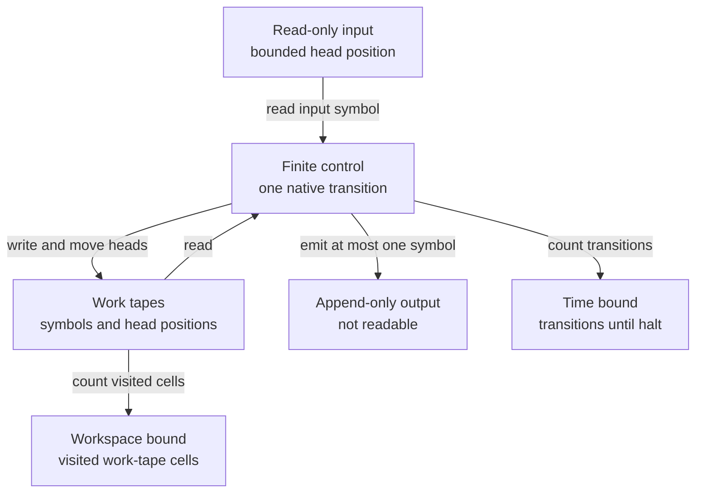

# Native machines and resource contracts

[Chapter index](index.md) · [Model map](../model-map.md)

## Configuration and uniformity

The underlying native configuration is cslib's [Turing.Cfg](https://github.com/leanprover/cslib/blob/254e30e6d4299c51323aaeaf5f51a4763b375d4a/Cslib/Computability/Machines/Turing/MultiTape/Configuration.lean#L97). Its input is a fixed list; the input head lies in `Fin (input.length + 2)`, with one blank boundary position on each side. Movement clamps at the boundaries. Each work tape is a function from integer positions to optional symbols, with an integer head. Output is a list to which a transition can append at most one symbol. Input is read-only and output is not readable. The action simultaneously chooses each work-tape write/move, input movement, optional output, and next optional control state. `none` in the control state denotes halting. [cslib][cslib]

A raw machine can have an arbitrary state or symbol type. Complexity predicates quantify one fixed number of tapes, finite state type, and binary-alphabet machine before quantifying over inputs. Encodings are explicit embeddings `α ↪ List Bool`; they do not by themselves promise a computable decoder or a decidable image. Native correctness therefore applies to all valid encoded values. A theorem over an encoded graph type does not automatically recognize malformed graph strings. [complexitylib][complexitylib]

The native execution model keeps data access and resource accounting separate:

The read/write arrows describe a transition; the counting arrows describe its resource contracts. Input and output are excluded from workspace, while emitting output still takes time. The diagram uses the finite-control machine required by [ComputableInTimeAndSpace](https://github.com/leanprover/cslib/blob/254e30e6d4299c51323aaeaf5f51a4763b375d4a/Cslib/Computability/Machines/Turing/MultiTape/Deterministic.lean#L352), with the components of [Cfg](https://github.com/leanprover/cslib/blob/254e30e6d4299c51323aaeaf5f51a4763b375d4a/Cslib/Computability/Machines/Turing/MultiTape/Configuration.lean#L97). The oracle extension below adds its own query buffers and reply heads.

The common extension [MultiTapeMachine](https://github.com/cslib-community/complexitylib/blob/13e6a31951bf1c89a1a6258c44f9444aecbbefd8/Complexity/Computability/Machines/Turing/MultiTape/Machine.lean#L148) adds a finite family of named oracle channels and a choice functor. A channel has a query buffer, a reply word and a reply-head position. An ordinary action writes at most one query symbol per channel and moves reply heads locally. A query action invokes one channel, clears that query buffer, installs the returned word and resets its reply head. Other channels and ordinary tapes retain their state, apart from the specified control continuation. Payloads are words; channel names identify operations, not payload values.

The specialization to no channels and `Id` is [step-exactly equivalent to the deterministic machine](https://github.com/cslib-community/complexitylib/blob/13e6a31951bf1c89a1a6258c44f9444aecbbefd8/Complexity/Computability/Machines/Turing/MultiTape/Machine/Equivalence.lean#L74); `Set` gives [the nondeterministic machine](https://github.com/cslib-community/complexitylib/blob/13e6a31951bf1c89a1a6258c44f9444aecbbefd8/Complexity/Computability/Machines/Turing/MultiTape/Machine/Equivalence.lean#L79). A clocked run is itself a program, through [runConfigFrom, runFrom and run](https://github.com/cslib-community/complexitylib/blob/13e6a31951bf1c89a1a6258c44f9444aecbbefd8/Complexity/Computability/Machines/Turing/MultiTape/Machine/Program.lean#L59), linking operational semantics to the free-program chapter.

## Choice changes semantics

| Native variant | Choice representation | What a branch means | Main uses |
|---|---|---|---|
| Deterministic `MultiTapeTM` | One action | One run, with halting fixed thereafter | P, DTIME, DSPACE, reductions and universal simulation |
| Nondeterministic `MultiTapeNTM` | Set of actions | Existence of an accepting path; repeated equal actions have no multiplicity | NP, NL, NSPACE, NPSPACE |
| `MultiTapePTM` | A Boolean-indexed pair of actions | One fresh fair bit per live instruction; equal successor actions still receive their full probability mass | Strict PPT, BPP/RP, randomized logspace, oracle verifiers |
| `MultiTapeCTM` | List of actions | Occurrences are distinguished by list indices, even when actions coincide | #P, GapP, exact acceptance/rejection counts |
| `MultiTapeATM` | Boolean pair plus state polarity | Existential control chooses one child; universal control requires both | AP and polynomial-length alternating games |

The definitions are [PTM](https://github.com/cslib-community/complexitylib/blob/13e6a31951bf1c89a1a6258c44f9444aecbbefd8/Complexity/Computability/Machines/Turing/MultiTape/Probabilistic.lean#L41), [CTM](https://github.com/cslib-community/complexitylib/blob/13e6a31951bf1c89a1a6258c44f9444aecbbefd8/Complexity/Computability/Machines/Turing/MultiTape/Counting.lean#L63), and [ATM](https://github.com/cslib-community/complexitylib/blob/13e6a31951bf1c89a1a6258c44f9444aecbbefd8/Complexity/Computability/Machines/Turing/MultiTape/Alternating.lean#L76). These differences cannot be recovered simply by reusing a set of successors: sets forget multiplicity, and probability and universal branching evaluate the resulting tree differently.

Nondeterministic acceptance is specifically a halted configuration whose output is exactly `[true]`, not a final state label or an output prefix. [DecidesInTime](https://github.com/cslib-community/complexitylib/blob/13e6a31951bf1c89a1a6258c44f9444aecbbefd8/Complexity/Computability/Machines/Turing/MultiTape/Complexity/Nondeterministic.lean#L192) requires every computation path of at least the specified duration to end halted. A path may instead become stuck earlier; it does not accept. [RecognizesInSpace](https://github.com/cslib-community/complexitylib/blob/13e6a31951bf1c89a1a6258c44f9444aecbbefd8/Complexity/Computability/Machines/Turing/MultiTape/Complexity/Nondeterministic.lean#L217) bounds every prefix on every path but permits infinite and stuck branches. [DecidesInSpace](https://github.com/cslib-community/complexitylib/blob/13e6a31951bf1c89a1a6258c44f9444aecbbefd8/Complexity/Computability/Machines/Turing/MultiTape/Complexity/Nondeterministic.lean#L231) additionally supplies a finite common bound on path length for each input. These clauses prevent an accepting short branch from masking unbounded workspace on another branch.

For counting, halting branches are counted at first halt. The CTM labelled transition system does not add artificial choices after halt. `HaltsWithin` and the nonblocking condition rule out the loss of branches at stuck live states where needed for class characterizations. This is distinct from the harmless halted self-loop used to pad nondeterministic reachability paths. [Counting definitions](https://github.com/cslib-community/complexitylib/blob/13e6a31951bf1c89a1a6258c44f9444aecbbefd8/Complexity/Computability/Machines/Turing/MultiTape/Counting.lean#L222)

For alternation, [AcceptsWithin](https://github.com/cslib-community/complexitylib/blob/13e6a31951bf1c89a1a6258c44f9444aecbbefd8/Complexity/Computability/Machines/Turing/MultiTape/Alternating.lean#L128) is a finite accepting-tree relation. A halted `[true]` configuration accepts; live existential and universal configurations use one or both successors respectively. `Accepts` existentially quantifies a finite depth. Infinite branches therefore do not obtain acceptance from coinductive interpretation. The polynomial-time class also supplies an all-branches time bound.

## Independent time, workspace, and encoded output

The base predicate [ComputableInTimeAndSpace](https://github.com/leanprover/cslib/blob/254e30e6d4299c51323aaeaf5f51a4763b375d4a/Cslib/Computability/Machines/Turing/MultiTape/Deterministic.lean#L352) keeps time and workspace independent. Workspace counts cells visited on the work tapes, including transient use; input and append-only output are excluded. The initial heads already occupy work cells. A time upper bound does not replace a separately asserted space bound.

Complexitylib deliberately has both output-uncharged and output-charged APIs:

| Predicate | Time | Workspace | Extra output charge |
|---|---|---|---|
| `ComputableInTimeAndSpace f … t s` | Exact supplied upper bound | Exact supplied upper bound | None |
| `ComputableInBigO f … T S` | `c (T+1)` | `c (S+1)` | None |
| `ComputableInO f … T S` | `c (T+1)` | `c (S+1)` | Encoded value also at most `c (S+1)` |
| `ComputableInSpace f … S` | Some input-dependent bound | `c (S+1)` | Same output bound |
| `ComputableInPolySpace` | Some input-dependent bound | Polynomial in input length | Polynomial encoded output |
| `ComputableInDegree … d e` | Degree `d` | Degree `d` | Independent output degree `e` |
| `ComputableInLogSpace` | No externally prescribed clock | `O(log n + 1)` | None |

The definitions and the documented reason for the output charge are in [ResourceBounds.lean](https://github.com/cslib-community/complexitylib/blob/13e6a31951bf1c89a1a6258c44f9444aecbbefd8/Complexity/Computability/Machines/Turing/MultiTape/ResourceBounds.lean#L88). The charge supports composition when returned values must subsequently occupy work tapes. It matters below linear space: copying an arbitrary input is a logarithmic-workspace transduction but cannot satisfy `ComputableInSpace` with a logarithmic output charge. For decision problems, one output bit makes the distinction asymptotically immaterial. The intended public direction uses plain computability; tidy cleanup and head rewinding remain in machine-level construction proofs and some transitional interfaces at this snapshot.

[Degree.BitString](../../Complexity/Computability/Machines/Turing/MultiTape/Complexity/Degree/BitString.lean) certifies linear conversion between raw words (`encBits`) and the existing framed Boolean-list encoding (`encList encBool`). Its [Cut module](../../Complexity/Computability/Machines/Turing/MultiTape/Complexity/Degree/BitString/Cut.lean) composes those streaming conversions with the existing unary list cutters. `ComputableInDegree.bitsTake` and `bitsDrop` charge the complete raw word and unary count, including empty words and counts beyond their length. Existing plain polynomial wrappers now reuse these stronger certificates. The [adaptive-game tape client](../../ComplexityTests/Crypto/LeveledTapePartition.lean) certifies its actual choose/encrypt/guess partition in time and output-charged workspace `O(tape.length + chooseCoins + encCoins + 1)`; callback execution and the complete reduction clock remain separate obligations.

`FTIME` is the corresponding function-time class with explicit input and output encodings and affine time `c₁ t(n) + c₂`; its workspace has an arbitrary length-dependent bound. It adds no output charge beyond the time required to write the output. [FTIME](https://github.com/cslib-community/complexitylib/blob/13e6a31951bf1c89a1a6258c44f9444aecbbefd8/Complexity/Computability/Complexity/Classes/FunctionTime.lean#L46) `DTIME`, `NTIME`, `BPTIME`, `DSPACE` and `NSPACE` attach affine bounds to the relevant machine predicates; `P`, `NP`, `BPP`, `L`, `NL`, `PSPACE`, `NPSPACE`, `E`, `NE`, `EXP` and `NEXP` derive familiar bound families.

## Fair-coin efficiency

[IsPPTOn](https://github.com/cslib-community/complexitylib/blob/13e6a31951bf1c89a1a6258c44f9444aecbbefd8/Complexity/Computability/Probabilistic/PPT.lean#L71) says that one fixed finite PTM, under one polynomial clock, has exactly the encoded output distribution of a program on every input. This is strict bounded time, rather than expected time or a nonuniform machine family. The initial clocked semantics can truncate at its budget, but [exists_halting_machine](https://github.com/cslib-community/complexitylib/blob/13e6a31951bf1c89a1a6258c44f9444aecbbefd8/Complexity/Computability/Probabilistic/PPT/Clock.lean#L77) realizes the same semantics by an actually halting machine. Closed interpretation supplies fair Boolean draws; an open PTM's coin operation has no prescribed distribution until interpreted.

Coin-tape theorems compile a strict PPT computation into a deterministic native evaluator of a polynomial-length seed, and conversely realize the usual fixed-seed verifier models. This supports the [PromiseBPP characterization](https://github.com/cslib-community/complexitylib/blob/13e6a31951bf1c89a1a6258c44f9444aecbbefd8/Complexity/Computability/Complexity/Classes/Promise/Probabilistic.lean#L149) and the time-bounded BPP union theorem. It does not make arbitrary Lean PMFs, exact uniform sampling from every finite cardinality, or hidden unbounded preprocessing free.

Randomized logarithmic space is defined directly over PTMs. Workspace is bounded on all prefixes of the nondeterministic projection, with a fresh one-way random bit at each live step. `RL` has acceptance at least one half on yes instances and zero on no instances; `BPL` uses two thirds and one third. Their definitions require all branches to terminate but initially do not prescribe a clock. Finite configuration counting derives a polynomial clock, and matrix/counting simulations yield `RL ⊆ P` and `BPL ⊆ P`. This is a particular all-branches-halting model; an expected-time randomized-space model is not silently substituted. [Randomized logspace](https://github.com/cslib-community/complexitylib/blob/13e6a31951bf1c89a1a6258c44f9444aecbbefd8/Complexity/Computability/Complexity/Classes/LogSpace/Randomized.lean#L15) [Polynomial-time containment](https://github.com/cslib-community/complexitylib/blob/13e6a31951bf1c89a1a6258c44f9444aecbbefd8/Complexity/Computability/Complexity/Classes/LogSpace/Randomized/PolyTime.lean#L246)

[Buffered probabilistic composition](../../Complexity/Computability/Machines/Turing/MultiTape/Probabilistic/Composition/Space.lean) also has an explicit all-prefix workspace bound for the existing `second.comp first mark` compiler. If the source uses at most `s₀` cells, every supported completed output has length at most `L`, and the consumer uses at most `s₁` cells on those outputs, the combined machine uses at most `(k₁+k₀+2) * (2 * max (max s₀ s₁) (L+2) + 1)` cells. The source must halt by its supplied clock; the consumer need not halt. Source scratch remains allocated, and two extra work tapes hold the intermediate word and its boundary marker. The proof bounds every head on every path prefix, independently of elapsed time. [Checked clients](../../ComplexityTests/ProbabilisticCompositionSpace.lean) compose the actual framed sampler with the native copying machine, rule out a zero-space certificate for the resulting two-tape machine, and also cover an endless zero-workspace consumer. This compiler theorem does not establish the complete FHE game clock or its source-relative runtime comparison ([#2722](https://github.com/cslib-community/complexitylib/issues/2722), [#2585](https://github.com/cslib-community/complexitylib/issues/2585)).

## Representative semantic tests

The source of [MachinePrograms.lean](https://github.com/cslib-community/complexitylib/blob/13e6a31951bf1c89a1a6258c44f9444aecbbefd8/ComplexityTests/MachinePrograms.lean#L24) distinguishes two nondeterministic successors, a stuck state, and a halted self-loop; it also checks channel isolation and fair-coin semantics. [CountingMachine.lean](https://github.com/cslib-community/complexitylib/blob/13e6a31951bf1c89a1a6258c44f9444aecbbefd8/ComplexityTests/CountingMachine.lean#L25) contains repeated equal accepting actions and checks three accepting versus one rejecting branch, first-halt padding stability, and malformed certificates. [Alternation.lean](https://github.com/cslib-community/complexitylib/blob/13e6a31951bf1c89a1a6258c44f9444aecbbefd8/ComplexityTests/Alternation.lean#L1) uses the same two choices with existential and universal polarity and obtains different acceptance outcomes. These are inspected regression witnesses, not test executions performed during the initial source review.

## Composing polynomial resource envelopes

For a polynomial-time map on pairs, import
[`Complexity.Computability.Machines.Turing.MultiTape.Complexity.PolyTime.Families`](../../Complexity/Computability/Machines/Turing/MultiTape/Complexity/PolyTime/Families.lean).
Given `hg : ComputableInPolyTime g (encPair encA encB) encC` and polynomial bounds `ha`, `hb`
on the encoded lengths of two input families, `hg.polynomiallyBounded_length_prod ha hb`
bounds the encoded output family. The families themselves need not be computable. The
[Levin](../../Complexity/Crypto/Computational/ZeroKnowledge/Levin.lean) and
[amplification](../../Complexity/Crypto/Computational/ZeroKnowledge/Amplification.lean)
proofs use this rule to transport witness families through the same deterministic reduction.

Import
[`ResourceBounds.Polynomial.Automation`](../../Complexity/Computability/Machines/Turing/MultiTape/ResourceBounds/Polynomial/Automation.lean)
and use `growth_poly` for `Turing.MultiTapeTM.PolyBounded size cost`. Local certificates supply
the leaves; constants, the original size, sums, products, fixed powers, natural logarithms and
square roots compose. Existing `Cslib.PolynomiallyBounded` goals use their `fun_prop` rules.
For substitution, apply `PolyBounded.comp` with the outer certificate and run `growth_poly`
on the inner size expression. This keeps the intermediate measure explicit.

The tactic closes a polynomial-growth goal or fails. Exponentials, variable exponents and
factorials need independent bounds and are rejected by the
[ordinary-import examples](../../ComplexityTests/PolynomialGrowth.lean). Exact instruction
allowances, encoded-output bounds and physical word fits remain separate obligations; a coarse
polynomial envelope does not certify a particular word width or a fixed degree.

When a final statement uses one constant as both coefficient and degree, import
[`ResourceBounds.Polynomial.Envelope`](../../Complexity/Computability/Machines/Turing/MultiTape/ResourceBounds/Polynomial/Envelope.lean)
and apply `PolyBounded.exists_le_self_pow` after composing the polynomial overhead. It supplies
`u a ≤ K * size a ^ K` at every positive size; size zero is excluded, so add a constant to the
chosen size when the contract includes empty inputs. Keep any exponential time factor outside
this polynomial envelope. The
[native packet resource proofs](../../Complexity/Computability/Circuit/Frontier/TensorNetwork/PacketTerms.lean)
combine polynomial preprocessing/postprocessing this way while retaining their separate
exponential time and polynomial space conclusions.

Pure lookup in `frame u ++ v` uses the small
[`Encodings.Frame.Lookup`](../../Complexity/Computability/Machines/Turing/MultiTape/Encodings/Frame/Lookup.lean)
module. `getElem?_frame_append` identifies each marker and data bit;
`getElem?_frame_append_boundary` identifies the terminator and suffix, including out-of-bounds
lookup. Both the unary take/drop and zip-transducer machine proofs use these list laws, so
clients can reuse them without importing either machine implementation.

[complexitylib]: ../sources.md#complexitylib
[cslib]: ../sources.md#cslib
