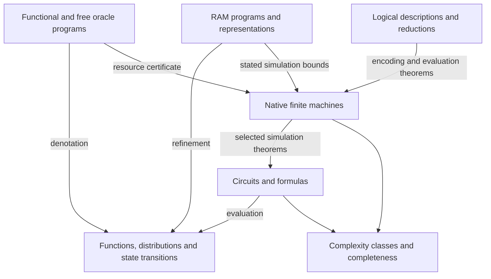

# From the dossier to a paper

The strongest organizing claim is that cslib-frontier makes complexity-theoretic models usable through explicit semantic and resource interfaces, and that its development provides a substantial observational case of human-directed automated formalization. The paper should support these two claims separately: source and theorem statements for the first, provenance and development records for the second.

## Proposed reader path

1. **Purpose, scope and provenance.** State the fixed revision, relationship to Lean/Mathlib/CSLib, and the distinction between reused mathematics, ports, new formalizations and proposed results. Explain that the paper surveys models and major endpoints rather than reproducing every proof.
2. **A semantic core with explicit resources.** Introduce the native machine conventions, encodings, uniformity and time/space/output distinctions. Use one small client to explain program semantics, resource certificates and machine realization.
3. **The model atlas.** Organize machines, circuits, information-access models, logics, probabilistic games and RAM/specification models by what they compute and charge. Put the full [model map](model-map.md) and declaration links in supplementary material.
4. **Major theorems and bridges.** Select representative endpoints with their limiting hypotheses. Include model equivalences and simulations alongside celebrated named theorems, because those bridges explain how the library fits together.
5. **Proof engineering.** Describe named certificates, loop invariants, circuit sharing, stateful refinement, modules, upstream reuse and API migration. Use source-linked examples and bounded before/after refactors.
6. **Assurance.** Separate proof checking, axioms, semantic review and source correspondence. State what was checked at the chosen revision; if it predates 2026-11-08, also cover the formal abstracts and comparator contracts and why they were retired.
7. **Automated development study.** Present the record-selection method, units and denominators before throughput figures. Combine timing with examples of human steering, failures, recovery and infrastructure work. Preserve the desktop coverage limitation if unresolved.
8. **Limitations and research directions.** Distinguish open mathematical endpoints, unproved tight simulation bounds, unsupported model equivalences, implementation limitations and evidence missing from the empirical study.

## One architectural figure

The arrows below label kinds of proved connection, not an assertion that every object in a layer has an efficient realization.

An optional empirical companion is the integration and observation timeline generated by [plot_history.py](development-history/data/plot_history.py). Its inputs and output are untracked; see [regeneration](BUILD.md#regenerating-research-outputs). Use it with the [timing methodology](development-history/timings.md): log bars mark first-to-last observations, not continuous data coverage or labor.

## Claims to retain with their qualifiers

| Candidate claim | Required qualification |
|---|---|
| Broad model coverage | A curated inventory of model families/variants supported by a full file census; not a line-by-line proof audit |
| Concrete complexity bounds | State encoding, machine/basis, quantifier order, uniformity and output-space conventions |
| Automated development at large scale | Human-directed process, reused foundations, incomplete cross-machine records and no causal productivity baseline |
| Successful independent review | Agent review of stated scope and revision; not human review or a guarantee of semantic fidelity |
| Rapid integration | Git/PR/calendar intervals, not isolated theorem-proving time |
| New or surprising mathematical endpoints | Exact manuscript version and formal scope, independent semantic scrutiny, no inferred community acceptance |

## Editorial work still needed

Choose the submission venue and length, confirm contributor roles and authorship, select a manageable main-text theorem set, and turn the source mappings into final scholarly citations. Resolve or explicitly bound the missing desktop corpus. This dossier supplies research evidence and a paper structure; it is not a submitted manuscript, and no academic authorship or publication action has been taken.
