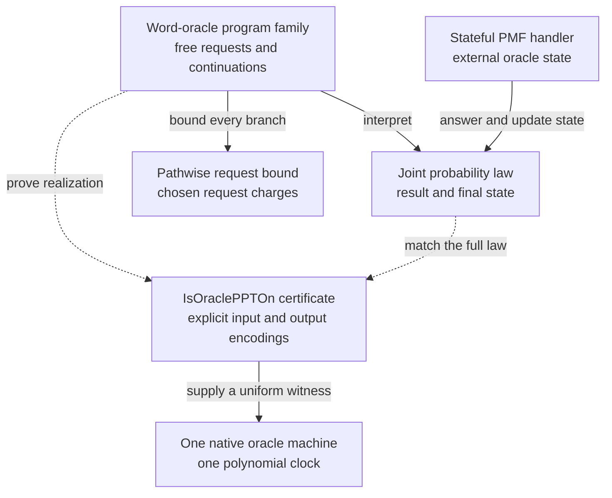

# Programs, probability laws, and native realization

## Typed free programs

[OracleSpec](https://github.com/cslib-community/complexitylib/blob/13e6a31951bf1c89a1a6258c44f9444aecbbefd8/Complexity/Languages/Probabilistic/Basic.lean#L54) assigns a reply type to each request. [OracleComp](https://github.com/cslib-community/complexitylib/blob/13e6a31951bf1c89a1a6258c44f9444aecbbefd8/Complexity/Languages/Probabilistic/Basic.lean#L57) is `PFunctor.FreeM` over that signature. A node issues one request and chooses its continuation from the reply; a leaf returns a value. This is well-founded adaptive interaction. It is not an unbounded looping language. A general signature may have infinitely many replies, so well-foundedness should not be paraphrased as a single uniform finite depth for every generic program [complexitylib][complexitylib].

[interpret](https://github.com/cslib-community/complexitylib/blob/13e6a31951bf1c89a1a6258c44f9444aecbbefd8/Complexity/Languages/Probabilistic/Basic.lean#L72) uses the free-monad universal interpreter. The handler can target any suitable monad: a PMF gives a law, a state transformer stores private evolving oracle state, and another `OracleComp` implements an oracle reduction. `interpret_interpret` is the algebraic substitution law. The file credits Devon Tuma and the VCVio work of Tuma, Quang Dao and collaborators; reuse of `PFunctor.FreeM` comes from cslib.

[ProbComp](https://github.com/cslib-community/complexitylib/blob/13e6a31951bf1c89a1a6258c44f9444aecbbefd8/Complexity/Languages/Probabilistic/Basic.lean#L141) specializes the signature to requests `n : Nat` returning `Fin (n+1)`. Its [eval](https://github.com/cslib-community/complexitylib/blob/13e6a31951bf1c89a1a6258c44f9444aecbbefd8/Complexity/Languages/Probabilistic/Basic.lean#L159) answers with the exact uniform PMF. Finite branching gives ordinary finite sampling trees. The type is not restricted to fair coins and does not attach a cost to Lean computations inside continuations. A long pure function and a short pure function can have the same query count.

## One semantics with several views

[Complexity/Languages/Probabilistic/Semantics.lean](https://github.com/cslib-community/complexitylib/blob/13e6a31951bf1c89a1a6258c44f9444aecbbefd8/Complexity/Languages/Probabilistic/Semantics.lean) provides `evalWith` for independent handlers, `supportWith` for allowed response sets, and `runWith` for the joint law of result and final hidden state. Support correspondence lemmas connect probabilistic execution to relational reachability. [runWith](https://github.com/cslib-community/complexitylib/blob/13e6a31951bf1c89a1a6258c44f9444aecbbefd8/Complexity/Languages/Probabilistic/Oracle/Interaction.lean#L61) specializes this to private samples plus typed external calls; [Oracle/Simulation.lean](../../Complexity/Languages/Probabilistic/Oracle/Simulation.lean) states its invariant, simulation and state-representation rules (`runWith_invariant`, `runWith_map_state`, `runWith_run_interpret`, …), so proofs need not unfold it to the interpretation of the sum handler. Interactive provers, cryptographic oracles and data-structure methods reuse this stateful semantics.

The final state matters: an adversary can observe consequences of an earlier call through later calls. Equality of output marginals alone is too weak for general oracle substitution. Native open-program realization therefore quantifies equality of the joint result/state law against every stateful PMF handler, not just against a fixed memoryless oracle.

The adjacent modules supply different semantic tools, not alternative machines:

| Tool | Source | Role |
|---|---|---|
| Pathwise query/cost bounds | [Complexity/Languages/Probabilistic/QueryCount.lean](https://github.com/cslib-community/complexitylib/blob/13e6a31951bf1c89a1a6258c44f9444aecbbefd8/Complexity/Languages/Probabilistic/QueryCount.lean) | Bound every branch by an explicit request charge |
| Transcripts | [Complexity/Languages/Probabilistic/Transcript.lean](https://github.com/cslib-community/complexitylib/blob/13e6a31951bf1c89a1a6258c44f9444aecbbefd8/Complexity/Languages/Probabilistic/Transcript.lean) | Retain dependent request/reply pairs |
| Memoization and random oracles | [Complexity/Languages/Probabilistic/RandomOracle.lean](https://github.com/cslib-community/complexitylib/blob/13e6a31951bf1c89a1a6258c44f9444aecbbefd8/Complexity/Languages/Probabilistic/RandomOracle.lean) | Repeated calls receive the same cached random answer |
| Bidirectional random permutations | [Complexity/Languages/Probabilistic/RandomPermutation.lean](../../Complexity/Languages/Probabilistic/RandomPermutation.lean) | Forward/inverse consistency, `bidirDedup` query deduplication, and sampling without replacement; [RandomPermutation/ExtPermsCard.lean](../../Complexity/Languages/Probabilistic/RandomPermutation/ExtPermsCard.lean) bounds the permutations taking `k` prescribed values at `k` distinct points (`card_extPerms_ofFn_mul_descFactorial_le`) |
| Coupled simulation and until-bad | [Complexity/Languages/Probabilistic/UntilBad.lean](https://github.com/cslib-community/complexitylib/blob/13e6a31951bf1c89a1a6258c44f9444aecbbefd8/Complexity/Languages/Probabilistic/UntilBad.lean) | Transfer probability bounds until a designated bad event |
| Replay/forking | [Complexity/Languages/Probabilistic/Forking.lean](https://github.com/cslib-community/complexitylib/blob/13e6a31951bf1c89a1a6258c44f9444aecbbefd8/Complexity/Languages/Probabilistic/Forking.lean) | Explicit tapes and reply lists permit repeatable adversary runs |

An ideal full random function table and its lazy cache can have the same transcript distribution while radically different representation costs. Their semantic equivalence does not, by itself, prove efficient materialization of the full table. At the open `OracleComp` level, forward-only query deduplication wraps a program with `memoize OracleComp.query` ([Memoize.lean](../../Complexity/Foundations/Control/Monad/Memoize.lean)), while bidirectional permutation reductions wrap `PermOracleSpec α` programs with `RandomPermutation.bidirDedupStep` / `RandomPermutation.bidirDedup` ([RandomPermutation.lean](../../Complexity/Languages/Probabilistic/RandomPermutation.lean), checked in [RandomPermutationSwitching.lean](../../ComplexityTests/RandomPermutationSwitching.lean)) so both forward hits in `dom(cache)` and inverse hits in `ran(cache)` reuse cached answers without repeating underlying oracle calls, preserving `evalPerm π` output laws, pathwise query bounds, and pairwise-distinct domain/range cache invariants.

## Closed strict polynomial time

[IsPPTOn](https://github.com/cslib-community/complexitylib/blob/13e6a31951bf1c89a1a6258c44f9444aecbbefd8/Complexity/Computability/Probabilistic/PPT.lean#L71) asserts that the encoded output distribution of `program a` equals the encoded run of one finite-control fair-coin multitape machine for `c * (|input a|+1)^d` steps, with one choice of machine, `c` and `d` for all `a`. The run is clocked. [Complexity/Computability/Probabilistic/PPT/Clock.lean](https://github.com/cslib-community/complexitylib/blob/13e6a31951bf1c89a1a6258c44f9444aecbbefd8/Complexity/Computability/Probabilistic/PPT/Clock.lean) turns the clocked witness into an intrinsically halting machine while charging the clock construction and maintenance. This is strict polynomial time, not expected polynomial time.

Encodings are embeddings into bit lists. This gives faithful representations but does not by itself supply an efficient decoder. The `length_le` theorem derives a polynomial bound on every supported output's encoded length. Congruence transfers the property through equality of laws. Deterministic `ComputableInPolyTime.isPPTOn` embeds ordinary native computation.

For a common coin and output budget, import [CoinTape.Bounds](../../Complexity/Computability/Probabilistic/CoinTape/Bounds.lean). `IsPPTOn.exists_total_seeded_evaluator_with_length` gives one polynomial envelope in the complete encoded input length. Every uniform tape at least that long replays the program exactly, and every supported encoded output fits the same envelope. The native evaluator returns a supported result even on shorter tapes; that support guarantee does not claim the correct distribution for a short tape. [Checked examples](../../ComplexityTests/SeededEvaluatorBounds.lean) use a random word sampler to exercise empty input, short tapes, longer uniform tapes and genuinely different supported outputs.

[IsPPT](https://github.com/cslib-community/complexitylib/blob/13e6a31951bf1c89a1a6258c44f9444aecbbefd8/Complexity/Computability/Probabilistic/Parameter.lean#L48) passes security parameter `n` in unary together with an auxiliary bit string. The clock is polynomial in the combined encoded input, not only in `n`. This is why a security claim over arbitrarily long samples is not automatically the same as a conventional polynomial-length ensemble statement.

At the snapshot, the inspectable formal abstract (since retired) used a finite random tape and a deterministic polynomial-time evaluator: [StrictPPT](https://github.com/cslib-community/complexitylib/blob/13e6a31951bf1c89a1a6258c44f9444aecbbefd8/abstracts/ComplexityAbstracts/Randomized.lean#L36). [strictPPT_iff](https://github.com/cslib-community/complexitylib/blob/13e6a31951bf1c89a1a6258c44f9444aecbbefd8/abstracts/ComplexityAbstracts/CryptographyBridge.lean#L59) related that presentation to the library's native predicate. It was an equivalent presentation with an explicit bridge, not a second unconnected efficiency convention.

For a list traversal with known component seed laws, import
[Languages.Probabilistic.Traverse.CoinTape](../../Complexity/Languages/Probabilistic/Traverse/CoinTape.lean).
`ProbComp.eval_mapM_of_uniformList` realizes the original `list.mapM program` by splitting
`list.length * width` uniform bits into rows and applying `List.zipWith evaluate` to inputs
and rows. The component law is required only for values in the supplied list. Repeated input
values still receive independent blocks; empty lists and width zero are allowed. This semantic
law supplies an explicit seed allocation, while native efficiency remains a separate obligation.
The existing `IsPPTOn.mapM` certificate uses this same law. The
[checked examples](../../ComplexityTests/TraversalCoinTape.lean) show distinct seeds at repeated
inputs and a component law that deliberately fails outside the input list.

## Open oracle polynomial time

[WordOracleComp](https://github.com/cslib-community/complexitylib/blob/13e6a31951bf1c89a1a6258c44f9444aecbbefd8/Complexity/Computability/Probabilistic/Oracle.lean#L56) combines private samples with a finite operation name and an arbitrary bit-string payload/reply. [IsOraclePPTOn](https://github.com/cslib-community/complexitylib/blob/13e6a31951bf1c89a1a6258c44f9444aecbbefd8/Complexity/Computability/Probabilistic/Oracle.lean#L63) chooses one native oracle machine and one polynomial clock before all inputs, state types, stateful handlers and starting states. The equality includes the final external state.

For the word-oracle interface, interpretation, query accounting and native realization are distinct proof tasks:

The dotted arrows are obligations of [IsOraclePPTOn](https://github.com/cslib-community/complexitylib/blob/13e6a31951bf1c89a1a6258c44f9444aecbbefd8/Complexity/Computability/Probabilistic/Oracle.lean#L63): one machine and clock must match the joint law for every input, stateful handler and starting state. The [request bound](https://github.com/cslib-community/complexitylib/blob/13e6a31951bf1c89a1a6258c44f9444aecbbefd8/Complexity/Languages/Probabilistic/QueryCount.lean) has no implication arrow to that certificate; it does not charge arbitrary pure continuation work. For a closed program, [IsPPTOn](https://github.com/cslib-community/complexitylib/blob/13e6a31951bf1c89a1a6258c44f9444aecbbefd8/Complexity/Computability/Probabilistic/PPT.lean#L71) instead matches the encoded output law without an external handler.

Request construction, tape-head movement and reply inspection are charged machine operations. The external handler's own computation is outside the oracle machine's cost. A reply may be arbitrarily long; the machine cannot return an arbitrarily long output for free, as the native `length_le` theorem records. Typed oracle interfaces need explicit word encodings and realization certificates before this native predicate applies.

[Complexity/Computability/Probabilistic/Oracle/Substitution.lean](https://github.com/cslib-community/complexitylib/blob/13e6a31951bf1c89a1a6258c44f9444aecbbefd8/Complexity/Computability/Probabilistic/Oracle/Substitution.lean) closes an efficient open program under efficient stateful oracle replacement. The principal endpoint `IsOraclePPTOn.run_interpret_preprocess_open` includes an invariant and controlled growth of replies and encoded handler state. Merely saying that each call is polynomial time would permit iterated state doubling and does not imply a polynomial total run. The underlying [Complexity/Computability/Probabilistic/Realization/OpenOracleSimulation.lean](https://github.com/cslib-community/complexitylib/blob/13e6a31951bf1c89a1a6258c44f9444aecbbefd8/Complexity/Computability/Probabilistic/Realization/OpenOracleSimulation.lean) supplies a machine-configuration simulation; the public theorem is supported by that realization.

Saved-coin execution reuses `MultiTapePTM.runConfigFromCoins` from
[`CoinTape.lean`](../../Complexity/Computability/Machines/Turing/MultiTape/Probabilistic/CoinTape.lean).
The native [`Replay/WithOracle.lean`](../../Complexity/Computability/Machines/Turing/MultiTape/Probabilistic/Replay/WithOracle.lean)
controller reads a supplied bit before executing the source instruction, so a query retains that
bit's branch and the original request/reply channels. `ReplayWithOracle.run_coins` equates the
complete programs in `2 * coins.length + 1` transitions, including the final stop. The controller's
own private samples may be discarded only under a stateless coin law. Its auxiliary-tape operations
are shared with the native clock in
[`Machine/AuxiliaryTape.lean`](../../Complexity/Computability/Machines/Turing/MultiTape/Machine/AuxiliaryTape.lean).
That controller bound assumes prepared tapes. The native `exists_oracleReplay` theorem in
[`Replay/WithOracleInput.lean`](../../Complexity/Computability/Machines/Turing/MultiTape/Probabilistic/Replay/WithOracleInput.lean)
adds pair decoding and virtual-input marking, proving a linear clock in the entire encoded
`(coins, input)` pair and actual halting. The shared pair preparer also serves closed replay.

[`Oracle/Replay.lean`](../../Complexity/Computability/Probabilistic/Oracle/Replay.lean) exposes
`MultiTapePTM.isOraclePPTOn_runCoins` and `IsOraclePPTOn.exists_savedCoins`. The latter starts with
an actual certified oracle-PPT program, fixes one bit per native instruction, and gives an efficient
replay whose polynomial-length uniform coin tape reproduces the joint encoded-output and external
state law for every stateful handler. Replies remain on their original channels; replay does not
copy an unbounded reply into a configuration encoding. This completes the replay prerequisite
[#2579](https://github.com/cslib-community/complexitylib/issues/2579). The Schnorr signing/hash/cache
and freshness bridge for the full ROM forking reduction remains
[#2568](https://github.com/cslib-community/complexitylib/issues/2568).

[`Oracle/ReplayParameter.lean`](../../Complexity/Computability/Probabilistic/Oracle/ReplayParameter.lean)
derives a public-key length bound `keyC * (n + 1)^keyD` from actual strict-PPT key generation.
`IsOraclePPT.exists_savedCoins_of_keyGen` then uses one uniform tape of length
`c * (2*n + 2 + keyC*(n + 1)^keyD)^d`, independent of the sampled key. Replay takes only the prefix
specified by the original full-input machine clock. Equality holds for every key within the derived
bound and retains the complete external state; the handler's own randomness stays external.
[`CoinTape/QueryBounds.lean`](../../Complexity/Computability/Machines/Turing/MultiTape/Probabilistic/CoinTape/QueryBounds.lean)
bounds calls on every fixed tape, including tapes outside the intended sampling support.

[`RandomOracle/Simulation.lean`](../../Complexity/Crypto/Protocols/Signature/RandomOracle/Simulation.lean)
transports such joint-state mixtures through the existing shared-world signature game. Its
`eval_worldRealize_eq_bind` includes the cache and signing log before final verification, and works
with any acceptance rule. In particular, final-message freshness permits repeated signing queries.
These shared laws complete [#2652](https://github.com/cslib-community/complexitylib/issues/2652);
the full efficient Schnorr reduction remains open.

[`Signature/WordRandomOracle.lean`](../../Complexity/Crypto/Computational/Signature/WordRandomOracle.lean)
routes Boolean channel `false` to signing and `true` to hashing. All word hash payloads remain
distinct, and digest replies use an injective encoding. `exists_eufCmaGame_savedCoinForger`
starts from actual strict-PPT key generation and an actual `IsOraclePPT` word forger, and proves
equality of the existing shared-world game and explicit-coin EUF-CMA game. One native machine
and clock work uniformly for all digest types and encodings, including parameter-dependent ones.
Its native replay
certificate charges the whole `(n, pk, coins)` input, the key-length guard, tape truncation, and
the existing total pair decoder. Oversized keys return the empty pair without calls; every tape
obeys the parameter-only call bounds, including tapes outside the sampling support. Plain
`ComputableInPolyTime.encoding_comp` supplies the encoded machine input.

This completes the generic word-forger adapter
[#2636](https://github.com/cslib-community/complexitylib/issues/2636). The scheme's signer, hash
handler and final verifier still run in the existing typed shared world. Native realizations of
those components, Schnorr's concrete query encoding, and the full efficient forking reduction are
separate obligations. Repeated signing/hash and fresh/replayed-message examples are checked in
[`Crypto/WordRandomOracle.lean`](../../ComplexityTests/Crypto/WordRandomOracle.lean).

## Exact versus approximate randomness

`ProbComp.uniform` permits exact finite uniform laws. A fair-coin machine with a fixed finite time bound has dyadic probabilities, so exact uniform sampling on three elements cannot follow simply from writing that program. This is a mathematical consequence of the definitions, not a reported failure. The sampling libraries distinguish power-of-two/dyadic laws, bounded samplers and approximate modular sampling. Group protocols can retain exact ideal PMFs and separately prove closeness and native efficiency of a word-level sampler.

For a concrete field with exact fair-bit sampling, import [Sampling/F4](../../Complexity/Computability/Probabilistic/Sampling/F4.lean). `F4.sample` draws the two Boolean coordinates of Mathlib's `QuadraticAlgebra (ZMod 2) 1 1`, where the generator satisfies `θ² = θ + 1`. `F4.eval_sample` proves exact uniformity over its four elements, and `F4.isPPTOn_sample` supplies the strict-PPT certificate under `F4.encoding`, the standard pair encoding of those coordinates. Addition, subtraction and multiplication have `F4.computableInPolyTime_add`, `F4.computableInPolyTime_sub` and `F4.computableInPolyTime_mul` certificates for the same encoding. These are fixed-field lookup certificates; they do not supply uniform arithmetic for a growing extension degree. Probability-only clients can import [the sampler semantics](../../Complexity/Languages/Probabilistic/Sampling/F4.lean) without the machine calculus. [Checked clients](../../ComplexityTests/F4Sampling.lean) compose the sampler into runtime-varying lists with the full independent uniform vector law.

When an optional sampler feeds a randomized continuation, [PMF/Option/Bind.lean](../../Complexity/Probability/PMF/Option/Bind.lean) provides `PMF.bind_option_apply_of_some`. A successful-part law `μ (some a) = mass * ν a` gives the scaled successful continuation plus `μ none * k none b`. This retains the actual failure branch without conditioning it away. The bounded-sampler Boolean-test proof uses the same law; [checked examples](../../ComplexityTests/PMFOptionBind.lean) distinguish accepting and rejecting failure branches while success flips a fresh fair bit.

Randomized Word-RAM takes another convention: one instruction may sample uniformly from any fitted finite interval. Its query count and `unifBitCost` are explicit currencies; neither equals the strict fair-coin runtime without a further implementation theorem. See [the RAM discussion](../algorithms-and-memory/wordram-and-bridges.md).

## Known Limitations

No expected-PPT machine predicate was identified in the surveyed probabilistic computability modules. The existing [ZPP definition](https://github.com/cslib-community/complexitylib/blob/13e6a31951bf1c89a1a6258c44f9444aecbbefd8/Complexity/Computability/Complexity/Classes/ZPP.lean#L79) uses native polynomial-time `Option Bool` trials: every returned Boolean is correct and at least half of the polynomial-length seeds return an answer. It is [proved equal to `RP ∩ coRP`](https://github.com/cslib-community/complexitylib/blob/13e6a31951bf1c89a1a6258c44f9444aecbbefd8/Complexity/Computability/Complexity/Classes/ZPP.lean#L266); an expected-polynomial-time characterization is not modeled here. See its [machine-model account](../machines-and-classes/verifiers-counting-interaction.md). This survey did not inspect every low-level composition proof or run the `ppt` tactic. Query-bounded ideal algorithms and native realizable algorithms remain distinct interfaces in the model map.

[complexitylib]: ../sources.md#complexitylib
